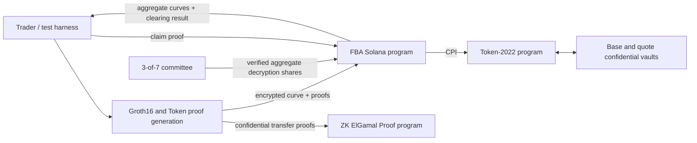
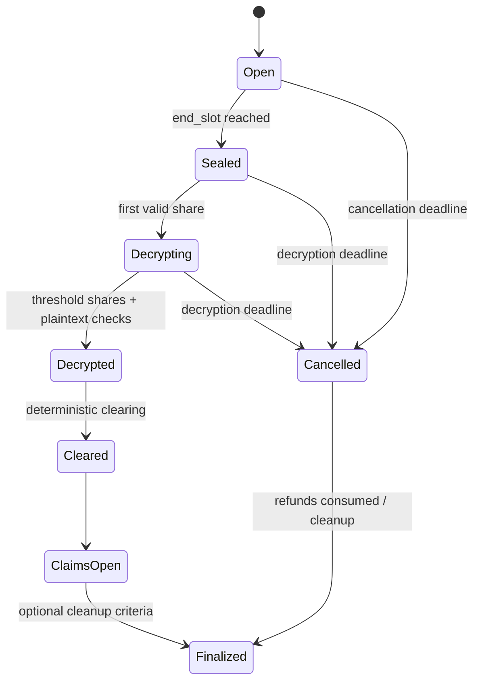

# Confidential Frequent Batch Auctions on Solana

## Technical Design

**Status:** Draft for prototype implementation

**Milestone:** Working prototype on test chain

**Last updated:** 2026-10-01

**Companion document:** [`fbaWithSol.md`](./fbaWithSol.md)

This document is the implementation reference for the Confidential Frequent Batch Auction (FBA) prototype. The companion document explains the market-design motivation. This document specifies the protocol, state machine, cryptographic boundaries, Solana accounts, instructions, tests, and known risks.

The prototype is intentionally designed so that individual orders remain confidential, aggregate curves become public only after an auction is sealed, clearing is deterministic, and possession of encryption material does not grant custody over escrowed tokens.

---

## 1. Prototype scope

### 1.1 Goals

The milestone must demonstrate an end-to-end auction on Solana:

1. A market opens an auction with an odd-sized public price grid.
2. Traders confidentially submit two-sided curves and lock confidential Token-2022 collateral.
3. The program homomorphically aggregates encrypted demand and supply.
4. After the auction seals, a 3-of-7 committee publishes verifiable threshold-decryption shares for the aggregate curves.
5. Anyone can reconstruct and verify the plaintext aggregate curves.
6. The program deterministically selects and stores the uniform clearing price.
7. A trader proves a claim without publishing the trader's original curve.
8. The trader receives the resulting assets and unused collateral through confidential Token-2022 transfers.
9. If settlement does not complete before a deadline, the auction moves to a cancellation/refund state.

The first implementation effort is the Solana programs, cryptographic harnesses, and automated tests.

### 1.2 Non-goals

The prototype does not attempt to provide:

- production-ready or audited cryptography;
- permissionless committee membership;
- production DKG with distributed inversion;
- protocol trading fees;
- protection against transaction censorship or general Solana liveness failures;
- compatibility with arbitrary existing SPL mints in the first demo;
- a polished trading UI.

### 1.3 Prototype assumptions

- The demo uses base and quote mints created with the Token-2022 Confidential Transfer extension enabled at mint creation.
- Traders pay Solana transaction fees and rent for their accounts. There is no additional protocol fee.
- An accepted order is immutable.
- Committee members communicate decryption shares onchain. Private setup material and secret shares never go onchain.
- A threshold of three committee members is trusted not to collude before sealing. A threshold collusion can reveal private order data but cannot move escrowed tokens without authorization from the auction program PDA.
- Grid size is a benchmarked parameter rather than a hard-coded design claim. Initial benchmark candidates are 21,31.. 51 price levels.

---

## 2. Privacy and trust model

### 2.1 Public information

The following information is public:

- market, auction, trader, committee, and token-account addresses;
- the fact that an address submitted or claimed an order;
- auction timing and state transitions;
- the price grid and grid parameters;
- encrypted order ciphertexts and cryptographic proofs;
- encrypted collateral movements;
- aggregate demand and supply curves after threshold decryption;
- the clearing price, executable volume, and public settlement parameters;
- whether an order has been claimed or refunded.

### 2.2 Confidential information

The protocol is intended to keep the following confidential:

- each order's demand and supply quantities at every price level;
- individual collateral amounts;
- individual fills, proceeds, and refunds;
- all other per-order values used as private witnesses in submission and claim proofs.

Individual orders remain confidential after clearing. Publishing aggregate curves does not authorize publication of individual curves.

### 2.3 Committee trust

Fewer than three committee members cannot decrypt a ciphertext under the auction key. Any three members can collude and decrypt aggregate or individual order ciphertexts, including before an auction seals. The program can prevent early decryption shares from being accepted onchain, but it cannot prevent offchain collusion by a threshold.

Committee encryption keys are not token-account signing authorities. Escrow token accounts are owned by a program-derived authority. Knowing an ElGamal decryption key may reveal confidential amounts and allow proof generation, but it does not independently authorize token movement.

### 2.4 Liveness trust

Threshold-share withholding is a liveness failure. The onchain state machine responds by moving the auction to `Cancelled` after a configured deadline.

There is a separate Token-2022 constraint: producing an outgoing confidential transfer from a shared vault requires source-side proof material derived from the vault's confidential balance keys. A committee-independent refund from a shared confidential vault is not automatically provided by Token-2022. The prototype must resolve this through the vault-proof service described in Section 13. This is a feasibility gate, not a solved production property.

---

## 3. System architecture



The implementation has four logical components:

1. **FBA program:** owns canonical market, auction, order, decryption, clearing, claim, and cancellation state.
2. **Token-2022 and ZK ElGamal Proof programs:** custody confidential collateral and verify standard confidential-transfer proofs.
3. **Committee tools:** create threshold shares, monitor sealed auctions, generate verifiable aggregate decryption shares, and assist with vault proof generation.
4. **Rust test/proving harness:** creates curves, ciphertexts, Groth16 witnesses, Token-2022 proof contexts, transactions, and assertions. This is not a production trading client.

---

## 4. Cryptographic primitives

The prototype reuses Solana's twisted ElGamal types, encodings, proof programs,
and onchain ciphertext-arithmetic syscalls instead of introducing
`elastic-elgamal`. This keeps auction ciphertexts compatible with Token-2022
Confidential Balances and avoids maintaining two ElGamal formats. Solana does
not provide threshold key generation or threshold decryption, so the protocol
adds that layer around the same twisted ElGamal key as described in Sections 5
and 6.

### 4.1 Groups and scalar fields

Solana Confidential Balances use the Ristretto prime-order group over Curve25519. Let:

- `G` be the Ristretto base point used to encode token amounts;
- `H` be the independent Ristretto base point used for Pedersen openings and twisted ElGamal public keys;
- `s` be a non-zero ElGamal secret scalar;
- `P = s^-1 * H` be the corresponding Token-2022 ElGamal public key.

All point and scalar encodings must use the canonical formats used by `solana-zk-sdk` and `solana-zk-sdk-pod`.

### 4.2 Twisted ElGamal ciphertext

To encrypt a non-negative integer quantity `q`, the client chooses a random Pedersen opening `r` and computes:

```text
C = q * G + r * H       // Pedersen commitment
D = r * P               // decryption handle
E(q; r) = (C, D)
```

Decryption with `s` produces the encoded message point:

```text
C - s * D
  = qG + rH - s(r(s^-1 H))
  = qG
```

Recovering `q` from `qG` is a bounded discrete-log problem. The prototype constrains order and aggregate quantities so that clients can recover them with a lookup table or bounded baby-step/giant-step implementation.

The program itself does not solve discrete logarithms. A caller supplies `q`, and the program verifies `q * G` against the decrypted message point using Ristretto syscalls.

### 4.3 Additive homomorphism

Ciphertexts under the same public key add component-wise:

```text
E(q1; r1) + E(q2; r2)
  = (C1 + C2, D1 + D2)
  = E(q1 + q2; r1 + r2)
```

The program uses the no-std `spl-token-confidential-transfer-ciphertext-arithmetic` crate for ciphertext addition, subtraction, and scalar multiplication. This crate uses Solana's Curve25519/Ristretto syscalls onchain.

### 4.4 Groth16

Custom nonlinear order and claim relations use Groth16 over BN254:

- circuit and prover implementation: expected to use Arkworks;
- onchain verification: Light Protocol's `groth16-solana` verifier or a pinned derivative;
- verifying keys: compiled into the program for the prototype;
- proof and public-input serialization: canonical big-endian Solana BN254 encoding;
- proof `A`: negated exactly as required by the verifier;
- every circuit version has a distinct domain and verifying key.

The prototype may use an insecure deterministic setup for local development only. Demo artifacts must clearly identify the setup as non-production. A production deployment would require an appropriate trusted-setup process or a different proof system.

### 4.5 Required domain separation

Every signature, Fiat-Shamir transcript, commitment, and proof must bind at least:

```text
protocol version
program id
market id
key epoch
auction id
order id when applicable
proof purpose
```

This prevents valid material from being replayed across markets, auctions, circuit versions, or instruction types.

---

## 5. Committee key setup

### 5.1 Prototype setup

Solana's twisted ElGamal implementation does not include DKG or threshold decryption. A conventional DKG can share `s`, but deriving the Token-2022 public key `s^-1 * H` without reconstructing `s` requires a distributed inversion protocol.

The prototype can use a dealer-assisted setup:

1. Generate a non-zero random scalar `s` in an isolated setup tool.
2. Compute `P = s^-1 * H`.
3. Compute `A0 = s * H` and prove that the same `s` satisfies both
   `s * P = H` and `s * H = A0`. Equivalently, prove
   `log_P(H) = log_H(A0)`. This binds the shared secret to the twisted public
   key.
4. Generate the Token-2022 public-key-validity proof while `s` is available.
5. Choose a random degree-two Shamir polynomial:

   ```text
   f(x) = s + a1*x + a2*x^2
   ```

6. Assign participant `j` the non-zero public coordinate `x_j` and secret share `s_j = f(x_j)`.
7. Publish Feldman-style coefficient commitments using base `H`:

   ```text
   A0 = s * H
   A1 = a1 * H
   A2 = a2 * H
   ```

8. Each participant verifies:

   ```text
   s_j * H == A0 + x_j*A1 + x_j^2*A2
   ```

9. Erase the dealer's copy of `s` after the market vaults and onchain key epoch are configured.

The seven participant public shares `Y_j = s_j * H`, the coefficient commitments, and `P` are stored in the `KeyEpoch` state.

This is real 3-of-7 threshold decryption after setup, but it is not dealerless DKG.

### 5.2 Future DKG

A production design should replace dealer-assisted setup with:

1. a publicly verifiable DKG for a shared non-zero `s`;
2. a distributed inversion protocol that creates shares of `s^-1` or directly derives `s^-1 * H`;
3. a distributed proof of knowledge/validity for the resulting Token-2022 public key;
4. complaint, exclusion, and restart rules;
5. proactive resharing and key rotation.

This work is outside this milestone.

### 5.3 Key epochs

A market references a `KeyEpoch` rather than embedding permanent committee configuration. An auction records the key epoch used for its ciphertexts and claims. Key rotation creates a new epoch; it does not mutate historical auctions.

The prototype may use one key epoch for all demo auctions.

---

## 6. Threshold decryption

### 6.1 Per-ciphertext share

For aggregate ciphertext `(C, D)`, participant `j` publishes:

```text
T_j = s_j * D
```

The participant proves equality of discrete logarithms:

```text
log_H(Y_j) == log_D(T_j)
```

where `Y_j = s_j * H` is the participant's registered public share.

The proof is a Chaum-Pedersen/DLEQ proof bound to the auction, vector position, side, participant, ciphertext, and key epoch. Verification uses the native Ristretto group-operation and multiscalar-multiplication syscalls.

### 6.2 Combining shares

For any valid threshold set `J` containing three distinct participant coordinates, compute Lagrange coefficients at zero:

```text
lambda_j = product(-x_m / (x_j - x_m)) for all m in J, m != j
```

Then:

```text
T = sum(lambda_j * T_j)
  = s * D

M = C - T
  = q * G
```

A submitted plaintext `q` is accepted only if:

```text
q * G == M
```

### 6.3 Batched share proofs

Verifying one DLEQ proof for every member, side, and grid point may become expensive. The intended optimization is one batched DLEQ proof per submitted share chunk:

1. Derive unpredictable transcript weights `rho_i` after binding every `(D_i, T_j_i)` pair.
2. Compute:

   ```text
   D*   = sum(rho_i * D_i)
   T_j* = sum(rho_i * T_j_i)
   ```

3. Prove `log_H(Y_j) == log_D*(T_j*)` once.

The program uses Ristretto MSM syscalls to reproduce the linear combinations. The non-batched verifier is implemented first as the correctness baseline; batching is enabled only after equivalence and adversarial tests pass.

### 6.4 Share publication policy

- Shares are rejected before the auction is sealed.
- A participant may finalize at most one share per aggregate position or chunk.
- Duplicate participant indices do not count toward the threshold.
- Every share must verify against the participant public share registered in the auction's key epoch.
- The plaintext curve is accepted only after a threshold of valid shares has been combined and every plaintext point has been checked onchain.
- Individual-order decryption shares are never requested or accepted by the FBA program.

---

## 7. Market and price-grid model

### 7.1 Lot units

All program arithmetic uses integer lots:

- `base_lot_size`: smallest executable base quantity;
- `quote_lot_size`: smallest quote quantity;
- `price_lots`: quote lots per base lot;
- order quantities: base lots.

Intermediate multiplication uses checked `u128` arithmetic:

```text
quote_liability = price_lots * base_quantity_lots
```

Configuration must ensure that individual confidential transfers remain within Token-2022's supported confidential-transfer amount range and that aggregate recovery stays within the configured discrete-log bound.

### 7.2 Odd-sized grid

Every auction has:

```text
N = 2*k + 1
```

price levels. Index `k` is the reference price, normally the previous auction's clearing price. There are `k` ticks below and `k` ticks above it.

```text
price(i) = reference_price + (i - k) * tick_size
```

All grid parameters are fixed before the auction opens and included in proof domains.

For the first auction, `reference_price` is a market-configuration value.

### 7.3 Out-of-grid markets

An auction cannot clear outside its grid. If executable liquidity is concentrated at an edge, the result is still deterministic, but the next auction should recenter on the edge clearing price. Production safeguards such as oracle-relative circuit breakers are outside the prototype.

---

## 8. Order representation and validity

### 8.1 Two encrypted vectors

Each order stores two ciphertext arrays under the auction's Token-2022-compatible key:

```text
buy[0..N)   // demand if the auction clears at each candidate price
sell[0..N)  // supply if the auction clears at each candidate price
```

Each entry is a 64-byte `PodElGamalCiphertext` containing a Pedersen commitment and decryption handle.

An order may quote both sides at different price levels. At a single price level it may contribute to at most one side.

### 8.2 Private validity constraints

For every tick `i`, the submission proof enforces:

```text
buy_i >= 0
sell_i >= 0
buy_i * sell_i == 0
```

The curves are monotonic:

```text
buy_i >= buy_(i+1)
sell_i <= sell_(i+1)
```

This permits a buy region, an optional zero/spread region, and a sell region. It prevents a single submitted curve from buying and selling at the same clearing price. It does not prevent coordinated wash trading through separate orders or identities.

Every value must be within market-configured per-level and per-order bounds.

### 8.3 Collateral requirements

For a two-sided curve:

```text
required_base_collateral  = max_i(sell_i)
required_quote_collateral = max_i(price_i * buy_i)
```

Only one clearing price is selected, so liabilities are maxima across possible outcomes, not sums across all grid points.

The submission proof binds these private requirements to the confidential base and quote collateral transfers.

### 8.4 Order binding

The order proof must bind all of the following:

- market and auction identifiers;
- key epoch and auction public key;
- complete buy and sell ciphertext arrays;
- all plaintext quantities and Pedersen openings;
- grid parameters;
- base and quote collateral transfer commitments;
- the order owner and unique order id;
- circuit and protocol versions.

The central circuit-engineering problem is binding BN254 Groth16 witnesses to Ristretto twisted-ElGamal ciphertexts. The currently specified approach is for the order-validity circuit to verify the Ristretto commitment/handle relations using non-native constraints, while the onchain program verifies the resulting Groth16 proof with BN254 syscalls.

This cross-curve circuit is a mandatory feasibility spike. Standard Solana range and ciphertext-validity proofs should be reused where they reduce circuit size, but they do not by themselves prove all curve, exclusivity, collateral-max, and claim relations.

### 8.5 Immutability and chunking

Large vectors and proofs may not fit comfortably in one transaction. Order creation therefore uses a staged protocol:

1. `initialize_order` creates an unfinalized order PDA.
2. `write_order_chunk` writes non-overlapping ciphertext ranges.
3. `finalize_order` verifies completeness, proofs, collateral linkage, and timing; adds the ciphertexts to the auction aggregates; and makes the order immutable.

Only finalized orders participate in an auction. Unfinalized order accounts can be closed by their funder after expiry and never affect aggregate state.

---

## 9. Encrypted aggregation

The auction stores aggregate ciphertext vectors:

```text
aggregate_buy[i]  = sum(order.buy[i])
aggregate_sell[i] = sum(order.sell[i])
```

`finalize_order` performs the additions exactly once. The order PDA records that it has been aggregated, preventing duplicate contribution.

The aggregate account is a writable hotspot. This is acceptable for the demo. A future version can use sharded accumulators followed by a reduction phase.

After sealing, aggregate ciphertexts are immutable.

---

## 10. Auction lifecycle



### 10.1 Slot-based timing

Program deadlines use Solana slots rather than wall-clock timestamps:

- `open_slot`;
- `submission_end_slot`;
- `decryption_deadline_slot`;
- `claim_or_refund_expiry_slot`, if cleanup is supported.

State transitions after deadlines are permissionless instructions. No privileged crank is required to seal, clear, or cancel an eligible auction.

### 10.2 Pipelining

Auctions are independent accounts. Auction `n+1` can accept orders while auction `n` is decrypting, clearing, or processing claims. Collateral remains scoped to the order and auction that locked it until settlement or refund.

---

## 11. Deterministic clearing

After decryption, the program stores plaintext arrays:

```text
D[i] = aggregate demand at price i
S[i] = aggregate supply at price i
V[i] = min(D[i], S[i])
```

The clearing price maximizes executable volume. Ties are resolved by:

1. selecting the price closest to the previous clearing price;
2. if two prices are equally distant, selecting the lower price.

Because the grid is centered on the previous clearing price, this is implemented by scanning:

```text
k, k-1, k+1, k-2, k+2, ... 0, 2k
```

The program updates the winner only when a strictly greater volume is found. The first occurrence of an equal maximum therefore wins, implementing both tie-breakers.

Pseudocode:

```text
best_index  = k
best_volume = min(D[k], S[k])

for index in zigzag_indices(k):
    volume = min(D[index], S[index])
    if volume > best_volume:
        best_index  = index
        best_volume = volume
```

If every price has zero executable volume, the center/reference price remains the clearing price and clearing volume is zero.

All arithmetic is checked. A malformed plaintext curve, out-of-range aggregate, or overflow aborts finalization.

---

## 12. Allocation and rounding

The exact per-order allocation rule has not yet been approved and must be frozen before the claim circuit is finalized.

The leading prototype candidate is:

- every order with non-zero quantity on the short side at the clearing price fills that quantity;
- the long side is filled proportionally using its quantity at the clearing price;
- the claim circuit proves the proportional calculation and the specified integer rounding;
- base and quote residuals are assigned explicitly to an auction residual account rather than being silently lost.

This candidate is attractive because a trader can calculate a claim using the trader's private quantity and public aggregate totals. It does not provide conventional price-time priority among all eligible orders.

Before implementation, the final rule must specify:

- whether price priority applies before pro-rata allocation;
- the exact numerator and denominator for each side;
- floor/ceiling behavior for base and quote quantities;
- how conservation is maintained when individual divisions leave remainders;
- who owns base and quote dust;
- maximum rounding loss per order;
- zero-volume and one-sided edge cases.

This is a protocol decision, not an implementation detail. Tests and circuit constraints must encode the final rule exactly.

---

## 13. Claim and confidential settlement

### 13.1 Claim proof statement

The intended claim proof demonstrates, without revealing the order, that:

1. the prover knows the plaintext quantities and openings behind the finalized order ciphertexts;
2. the order is bound to the specified market, auction, owner, and key epoch;
3. the public clearing result is the one stored by the program;
4. the claimed fill follows the allocation and rounding rules;
5. the purchased asset, proceeds, unfilled collateral, and residual treatment are correct;
6. the confidential Token-2022 transfer commitments encode those correct outputs;
7. the claim nullifier is derived from the finalized order and cannot be reused.

The proof does not reveal the order quantities, fill, refund, or transfer amounts.

### 13.2 Claim state

For the prototype, each finalized order PDA contains a terminal status:

```text
Pending
Claimed
Refunded
```

The program changes `Pending` to `Claimed` or `Refunded` in the same transaction that authorizes the relevant token movement. This prevents replay and double withdrawal.

### 13.3 Token-2022 source proof requirement

Token-2022 confidential transfers require source-side proofs against the vault's current encrypted available balance. The trader does not possess the shared vault's ElGamal/AES proof material.

The prototype therefore includes an offchain **vault-proof service**, initially operated alongside the committee:

1. The trader generates the claim Groth16 proof and the desired destination ciphertext material.
2. The vault-proof service validates the claim inputs or waits for an accepted claim-preparation state.
3. A threshold reconstructs or otherwise makes the required vault proof material available for the duration of proof generation.
4. The service generates the standard Token-2022 transfer proof contexts.
5. The trader or any relayer submits the final claim transaction.
6. The FBA program verifies the claim proof and signs the Token-2022 CPI with PDA seeds.

The vault-proof service cannot move tokens by itself because it cannot sign for the vault authority PDA. It is nevertheless a privacy and liveness component and must be described honestly in the demo.

### 13.4 Pending and available balances

Incoming confidential Token-2022 transfers first increase the vault's pending balance. Funds must be applied into the available balance before they can fund outgoing claims. The program/test harness must track pending-balance counters and include an explicit vault-apply step in the auction pipeline.

### 13.5 Timeout refund

After the cancellation deadline:

- clearing and claims are disabled;
- a finalized order may be refunded at most once;
- the refund is the full base and quote collateral originally deposited for that order;
- the refund proof binds to the original collateral-transfer commitments and order PDA;
- the order becomes `Refunded` atomically with token authorization.

A shared confidential vault still requires valid Token-2022 source proofs for the refund. A truly committee-independent refund mechanism is unresolved. The prototype fallback guarantees an onchain cancellation state and program-authorized refunds when the vault-proof service is available; it does not yet guarantee cryptographic refund liveness if all offchain holders of vault proof material disappear.

This limitation is a mandatory item for the demo threat-model disclosure and a priority for a post-hackathon design.

---

## 14. Onchain account model

Exact byte layouts will be frozen during implementation. The logical model is:

### 14.1 `Market`

```text
version
authority
base_mint
quote_mint
base_vault
quote_vault
vault_authority_bump
base_lot_size
quote_lot_size
tick_size
grid_radius_k
max_order_quantity
max_aggregate_quantity
current_key_epoch
last_clearing_price
next_auction_id
timing configuration
allocation_rule_version
order_circuit_version
claim_circuit_version
paused flag
```

Suggested seeds:

```text
["market", base_mint, quote_mint, market_nonce]
```

### 14.2 `KeyEpoch`

```text
market
epoch_number
twisted_elgamal_pubkey P
threshold = 3
participant_count = 7
participant signing addresses
participant coordinates x_j
participant public shares Y_j
polynomial coefficient commitments
validated P/A0 key-relation proof digest
activation slot
retirement slot / status
```

Suggested seeds:

```text
["key-epoch", market, epoch_number]
```

### 14.3 `Auction`

```text
market
auction_id
key_epoch
state
open_slot
submission_end_slot
decryption_deadline_slot
reference_price
tick_size
grid_size
finalized_order_count
aggregate_buy ciphertext vector
aggregate_sell ciphertext vector
valid share bitmap / counters
decrypted demand vector
decrypted supply vector
clearing_index
clearing_price
clearing_volume
allocation parameters
residual accounting
```

The aggregate and decrypted vectors may be placed in separate PDAs if required by size or mutation patterns.

Suggested seeds:

```text
["auction", market, auction_id]
```

### 14.4 `Order`

```text
market
auction
order_id
owner
state: Writing | Finalized | Claimed | Refunded
grid_size
written chunk bitmap
encrypted buy vector
encrypted sell vector
base collateral transfer commitment/reference
quote collateral transfer commitment/reference
proof/circuit version
claim nullifier commitment
aggregated flag
```

Suggested seeds:

```text
["order", auction, owner, client_order_nonce]
```

### 14.5 `DecryptionSubmission`

```text
auction
participant index
chunk index
share points
proof bytes
verified flag
```

Suggested seeds:

```text
["decrypt", auction, participant_index, chunk_index]
```

Temporary submission accounts may be closed after the plaintext vectors have been finalized.

### 14.6 Token vaults

- One base and one quote Token-2022 account per market or key epoch.
- Token-account owner: market vault-authority PDA.
- Confidential encryption key: key-epoch twisted ElGamal public key.
- Mints: confidential transfers enabled and automatically approved for the demo.

Whether vaults are per market or per key epoch is finalized after testing Token-2022 key rotation and cleanup. Per-key-epoch vaults give cleaner key isolation.

---

## 15. Program instructions

### 15.1 Administration and setup

`initialize_market`

- validates Token-2022 mints and extensions;
- creates market state and vault-authority PDA configuration;
- stores lot, grid, timing, and bound parameters.

`initialize_key_epoch`

- stores `P`, participant configuration, and polynomial commitments;
- validates threshold and unique participant coordinates;
- binds a proof/circuit version;
- cannot mutate an existing epoch.

`activate_key_epoch`

- activates a fully configured key epoch for future auctions;
- does not change historical auctions.

### 15.2 Auction lifecycle

`open_auction`

- fixes slots, grid, reference price, key epoch, and proof versions;
- initializes zero aggregate ciphertexts.

`seal_auction`

- permissionless after `submission_end_slot`;
- prevents new or finalized order submissions.

`cancel_expired_auction`

- permissionless after the relevant deadline;
- transitions an unsettled auction to `Cancelled`.

### 15.3 Order collection

`initialize_order`

- creates an empty order PDA for the current open auction.

`write_order_chunk`

- writes an unused range of ciphertext entries;
- validates canonical point encodings and range boundaries;
- does not aggregate or accept the order.

`finalize_order`

- verifies the auction is still open;
- verifies all chunks are present;
- verifies the order-validity proof and Token-2022 collateral proof references;
- performs or confirms confidential collateral transfer(s);
- adds ciphertexts into aggregate vectors exactly once;
- marks the order immutable and finalized.

`close_unfinalized_order`

- allows the funder to reclaim rent after the submission window;
- is unavailable for a finalized order.

### 15.4 Decryption and clearing

`submit_decryption_chunk`

- accepts shares only after sealing;
- verifies participant membership and uniqueness;
- verifies the individual or batched DLEQ proof;
- stores verified share points.

`finalize_decrypted_chunk`

- selects three verified distinct members;
- combines shares;
- verifies caller-supplied plaintext quantities by point multiplication;
- writes plaintext aggregate entries.

`finalize_decryption`

- confirms every aggregate point has a verified plaintext;
- changes auction state to `Decrypted`.

`clear_auction`

- runs deterministic max-volume and zigzag tie-breaking;
- stores the clearing result and immutable public settlement parameters;
- changes state to `ClaimsOpen`.

### 15.5 Settlement

`prepare_claim` may be introduced if Token-2022 proof generation requires a two-step state transition. It must not allow an order to be claimed twice or reserve funds indefinitely.

`claim_order`

- verifies order ownership or an authorized relayer binding;
- verifies the claim Groth16 proof;
- verifies Token-2022 proof contexts and destination accounts;
- invokes Token-2022 transfers with the vault-authority PDA;
- marks the order `Claimed` atomically.

`refund_cancelled_order`

- requires auction state `Cancelled`;
- verifies the refund proof and original collateral binding;
- invokes full confidential refunds;
- marks the order `Refunded` atomically.

`apply_vault_pending_balance`

- invokes the required Token-2022 pending-to-available transition under controlled conditions;
- validates expected pending counters and key epoch.

---

## 16. Proof inventory

| Proof | Generated by | Verified by | Purpose |
|---|---|---|---|
| Token confidential transfer equality proof | Trader or vault-proof service | ZK ElGamal Proof + Token-2022 | Source balance and commitment consistency |
| Token grouped ciphertext validity proof | Trader or vault-proof service | ZK ElGamal Proof + Token-2022 | Same transfer amount is correctly encrypted for required parties |
| Token range proof | Trader or vault-proof service | ZK ElGamal Proof + Token-2022 | Non-negative balances and bounded transfer amount |
| Order-validity Groth16 proof | Trader | FBA program via BN254 verifier | Ciphertext openings, curve rules, bounds, and collateral linkage |
| Committee DLEQ proof | Committee member | FBA program via Ristretto syscalls | Correct threshold-decryption share |
| Claim Groth16 proof | Trader/test prover | FBA program via BN254 verifier | Correct private fill, refund, proceeds, and output commitments |
| Refund proof | Trader plus vault-proof service | FBA program and Token-2022 | Full collateral return after cancellation |

Proof context accounts must be checked for:

- expected owner program;
- expected proof type;
- expected public keys and ciphertexts;
- correct market/auction/order binding where supported;
- single intended consumption or safe replay semantics;
- closure only after the consuming instruction succeeds.

---

## 17. Serialization and compatibility rules

- Ristretto points and scalars use Solana ZK SDK canonical encodings.
- Token ciphertext state uses `PodElGamalCiphertext` rather than custom structs.
- BN254 public inputs use canonical 32-byte big-endian field encodings.
- The offchain proof exporter and onchain verifier share golden test vectors.
- Account data begins with a protocol version and state discriminator.
- No Rust enum or struct is serialized by relying on compiler layout.
- All vector lengths are checked against the auction's immutable grid size.
- All point encodings are validated before curve syscalls.
- All instruction payloads have explicit maximum lengths.

---

## 18. Security invariants

The implementation and tests must preserve these invariants:

1. An order can contribute to aggregate state at most once.
2. No order can finalize after the submission deadline.
3. No aggregate can change after sealing.
4. Decryption shares cannot be accepted before sealing.
5. Only registered committee indices from the auction's key epoch count toward threshold.
6. A decryption share must verify against both the registered public share and the exact aggregate ciphertext.
7. Plaintext aggregate entries must match the threshold-decrypted group points.
8. Clearing is a pure deterministic function of immutable grid and plaintext aggregates.
9. A claim proof is bound to one finalized order and one clearing result.
10. An order can reach only one of `Claimed` or `Refunded`.
11. Every token movement is authorized by the vault PDA only after the corresponding proof succeeds.
12. All multiplication, addition, indexing, and size calculations are checked for overflow.
13. Circuit/verifying-key versions cannot be substituted across proof types.
14. Failed proof or CPI execution leaves order and auction state unchanged.
15. Committee key material never grants the ability to sign as the vault PDA.

---

## 19. Testing strategy

### 19.1 Pure Rust tests

- price-grid construction and zigzag order for multiple `k` values;
- maximum-volume clearing and all tie cases;
- zero-volume auctions;
- lot and price overflow boundaries;
- order monotonicity and side-exclusivity constraints;
- collateral maximum calculations;
- twisted ElGamal add/subtract/multiply round trips;
- Shamir share generation and every valid 3-of-7 subset;
- rejection of two shares, duplicate indices, bad coordinates, and corrupted shares;
- DLEQ proof positive and negative vectors;
- plaintext point checks and bounded discrete-log recovery;
- Groth16 proof serialization, endianness, proof-A negation, and verifying-key conversion;
- claim and nullifier edge cases after the allocation rule is frozen.

Property-based tests should compare the encrypted pipeline against a plaintext reference implementation.

### 19.2 Program tests

- every state transition and invalid transition;
- slot-boundary behavior;
- duplicate order aggregation attempts;
- incomplete and overlapping order chunks;
- malformed point encodings and oversized vectors;
- early, duplicate, and wrong-member decryption shares;
- corrupted Groth16 proofs and mismatched public inputs;
- replay across auctions, markets, orders, and circuit versions;
- claim/refund mutual exclusion;
- CPI rollback behavior;
- PDA authority and account-substitution attacks.

### 19.3 Confidential Token-2022 integration tests

The standard `solana-test-validator` does not enable the ZK ElGamal Proof program used by Confidential Balances. Integration tests that exercise real proof-context and confidential-transfer behavior should run against:

- a supported local environment such as a Surfpool mainnet/devnet fork; and
- Solana devnet before the demo.

Tests must cover:

- mint and account configuration;
- deposit and apply-pending flow;
- trader-to-vault confidential transfer;
- vault pending/available accounting;
- program-authorized vault-to-trader transfer;
- proof-context creation, consumption, and closure;
- timeout refund;
- stale-balance proof rejection.

### 19.4 Benchmark matrix

For grid sizes `N = 5, 9, 17, 33`, record:

- order PDA bytes;
- auction aggregate bytes;
- transaction count and serialized transaction sizes;
- order-proof generation time and memory;
- claim-proof generation time and memory;
- Groth16 verification CU;
- ciphertext aggregation CU;
- individual and batched DLEQ verification CU;
- decryption-share transaction sizes;
- clearing CU;
- Token-2022 proof-generation and end-to-end settlement latency.

The supported demo grid is selected from measured results.

---

## 20. Implementation sequence

### Phase 0: feasibility gates

Before building the complete state machine, implement three isolated spikes:

1. **Twisted threshold decryption:** generate a dealer-assisted 3-of-7 key, aggregate ciphertexts, submit three DLEQ-proven shares, and verify a supplied plaintext using Ristretto syscalls.
2. **Groth16/Ristretto binding:** prove that private values and openings correspond to public Token-2022 ciphertexts, then verify the proof through `groth16-solana` in an SBF test.
3. **Shared-vault settlement:** perform a program-PDA-authorized confidential transfer out of a shared vault and exercise the same mechanism for cancellation refunds.

Failure of a spike triggers a design revision before the full program is built.

### Phase 1: plaintext auction core

- account skeletons and state machine;
- grid and slot handling;
- plaintext reference curve submission for tests only;
- deterministic clearing;
- property tests.

### Phase 2: encrypted collection

- order chunk accounts;
- twisted ElGamal ciphertext validation and aggregation;
- order finalization and immutability;
- size/CU benchmarks.

### Phase 3: committee decryption

- key-epoch state;
- DLEQ share verification;
- threshold combination and plaintext checks;
- sealed-to-decrypted lifecycle.

### Phase 4: collateral

- Token-2022 mints and confidential vaults;
- trader collateral transfers;
- pending-balance management;
- order/collateral proof binding.

### Phase 5: claims and fallback

- freeze allocation and rounding rule;
- claim circuit and verifier;
- vault-proof service harness;
- confidential payouts and refunds;
- cancellation path.

### Phase 6: demo hardening

- devnet deployment;
- scripted multi-trader auction;
- adversarial and replay tests;
- benchmark report;
- explicit prototype threat-model disclosure.

---

## 21. Demo flow

The scripted hackathon demonstration should show:

1. Creation of confidential base and quote Token-2022 mints and accounts.
2. Initialization of one market and a dealer-assisted 3-of-7 key epoch.
3. Opening an auction around the previous/reference price.
4. Submission of several confidential two-sided curves.
5. Onchain ciphertext aggregates changing while quantities remain unreadable.
6. Auction sealing.
7. Three committee members submitting valid decryption shares.
8. Publication of aggregate demand and supply curves.
9. Independent recomputation of the deterministic clearing price.
10. Onchain clearing result matching the independent result.
11. At least two private claims settling through confidential transfers.
12. A separate auction timing out and entering the refund path.

The demo should also show negative tests: an early share, corrupted share, corrupted claim proof, and double claim must fail.

---

## 22. Known risks and unresolved decisions

### 22.1 Must be resolved before claim-circuit implementation

- Exact allocation and rounding rule.
- Conservation and ownership of rounding residuals.
- Exact claim public inputs and nullifier construction.

### 22.2 Feasibility risks

- Cost and implementation complexity of binding Ristretto ciphertexts inside a BN254 Groth16 circuit.
- Source-proof generation for confidential transfers from a shared vault.
- Committee-independent refund liveness.
- DLEQ verification and share-vector transaction size at larger grids.
- Proof-generation latency suitable for a live demo.

### 22.3 Parameters selected by measurement

- supported grid size;
- per-order and aggregate quantity bounds;
- auction submission duration;
- decryption deadline;
- share chunk size;
- whether vaults are per market, key epoch, or auction.

### 22.4 Post-prototype work

- audited threshold twisted-ElGamal implementation;
- dealerless DKG with distributed inversion;
- distributed or otherwise trust-minimized Token-2022 vault proof generation;
- stronger anti-censorship and committee replacement;
- accumulator sharding and account compression;
- production trusted setup or alternative proof system;
- economic fee, spam, reserve, and incentive design;
- formal specification and independent security audit.

---

## 23. References

- Eric Budish, Peter Cramton, and John Shim, *The High-Frequency Trading Arms Race: Frequent Batch Auctions as a Market Design Response*.
- [Solana Confidential Balances documentation](https://www.solana-program.com/docs/confidential-balances)
- [Solana Confidential Transfer protocol overview](https://www.solana-program.com/docs/confidential-balances/overview)
- [Solana Token-2022 repository](https://github.com/solana-program/token-2022)
- [Solana ZK ElGamal Proof repository](https://github.com/solana-program/zk-elgamal-proof)
- [Solana twisted ElGamal implementation](https://github.com/solana-program/zk-elgamal-proof/blob/main/zk-sdk/src/encryption/elgamal.rs)
- [Solana Pedersen commitment implementation](https://github.com/solana-program/zk-elgamal-proof/blob/main/zk-sdk/src/encryption/pedersen.rs)
- [Light Protocol Groth16 verifier for Solana](https://github.com/Lightprotocol/groth16-solana)
