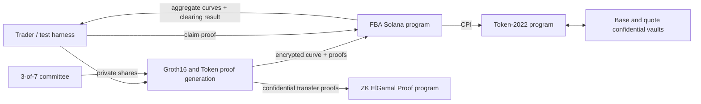
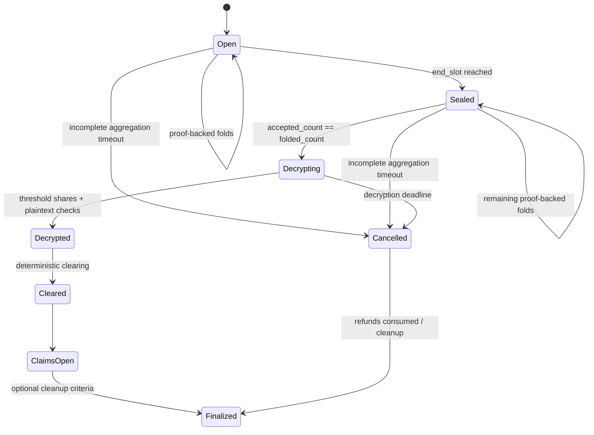

# Confidential Frequent Batch Auctions on Solana

## Technical Design

**Status:** Draft for prototype implementation

**Milestone:** Working prototype on test chain

**Last updated:** 2026-10-04

**Companion document:** [`fbaWithSol.md`](./fbaWithSol.md)

This document is the implementation reference for the Confidential Frequent Batch Auction (FBA) prototype. The companion document explains the market-design motivation. This document specifies the protocol, state machine, cryptographic boundaries, Solana accounts, instructions, tests, and known risks.

The prototype is intentionally designed so that individual orders remain confidential, aggregate curves become public only after an auction is sealed, clearing is deterministic, and possession of encryption material does not grant custody over escrowed tokens.

---

## 1. Prototype scope

### 1.1 Goals

The milestone must demonstrate an end-to-end auction on Solana:

1. A market opens an auction with an odd-sized public price grid.
2. Traders confidentially submit two-sided curves and lock confidential Token-2022 collateral.
3. The program homomorphically aggregates encrypted demand and supply.
4. After the auction seals, a 3-of-7 committee produces a proof-backed threshold decryption of the aggregate curves.
5. Anyone can verify the published plaintext aggregate curves and relay the proof onchain.
6. The program deterministically selects and stores the uniform clearing price.
7. A trader proves a claim without publishing the trader's original curve.
8. The trader receives the resulting assets and unused collateral through confidential Token-2022 transfers.
9. If settlement does not complete before a deadline, the auction moves to a cancellation/refund state.

The first implementation effort is the Solana programs, cryptographic harnesses, and automated tests.

### 1.2 Non-goals

The prototype does not attempt to provide:

- production-ready or audited cryptography;
- permissionless committee membership;
- production DKG with distributed inversion;
- protocol trading fees;
- protection against transaction censorship or general Solana liveness failures;
- compatibility with arbitrary existing SPL mints in the first demo;
- a polished trading UI.

### 1.3 Prototype assumptions

- The demo uses base and quote mints created with the Token-2022 Confidential Transfer extension enabled at mint creation.
- Traders pay Solana transaction fees and rent for their accounts. There is no additional protocol fee.
- An accepted order is immutable.
- Committee members provide decryption shares to a committee proof coordinator. Shares, DLEQ transcripts, private setup material, and secret shares never go onchain.
- A threshold of three committee members is trusted not to collude before sealing. A threshold collusion can reveal private order data but cannot move escrowed tokens without authorization from the auction program PDA.
- Grid size is a benchmarked parameter rather than a hard-coded design claim. The first SBF account-layout benchmark tested 17, 19, 21, 25, and 33 levels. With boxed Anchor accounts and the standard 4 KiB stack frame, 17 levels builds cleanly while 19 is the first monolithic layout whose `Auction` deserializer exceeds the frame. The prototype therefore caps the grid at 17 levels; larger grids require sharded curve accounts.

---

## 2. Privacy and trust model

### 2.1 Public information

The following information is public:

- market, auction, trader, committee, and token-account addresses;
- the fact that an address submitted or claimed an order;
- auction timing and state transitions;
- the price grid and grid parameters;
- encrypted order ciphertexts and cryptographic proofs;
- encrypted collateral movements;
- aggregate demand and supply curves after threshold decryption;
- the clearing price, executable volume, and public settlement parameters;
- whether an order has been claimed or refunded.

### 2.2 Confidential information

The protocol is intended to keep the following confidential:

- each order's demand and supply quantities at every price level;
- individual collateral amounts;
- individual fills, proceeds, and refunds;
- all other per-order values used as private witnesses in submission and claim proofs.

Individual orders remain confidential after clearing. Publishing aggregate curves does not authorize publication of individual curves.

### 2.3 Committee trust

Fewer than three committee members cannot decrypt a ciphertext under the auction key. Any three members can collude and decrypt aggregate or individual order ciphertexts, including before an auction seals. The program rejects aggregate-publication proofs outside the `Decrypting` window, but it cannot prevent offchain collusion by a threshold.

Committee encryption keys are not token-account signing authorities. Escrow token accounts are owned by a program-derived authority. Knowing an ElGamal decryption key may reveal confidential amounts and allow proof generation, but it does not independently authorize token movement.

### 2.4 Liveness trust

Threshold-share withholding is a liveness failure. The onchain state machine responds by moving the auction to `Cancelled` after a configured deadline.

There is a separate Token-2022 constraint: producing an outgoing confidential transfer from a shared vault requires source-side proof material derived from the vault's confidential balance keys. A committee-independent refund from a shared confidential vault is not automatically provided by Token-2022. The prototype must resolve this through the vault-proof service described in Section 13. This is a feasibility gate, not a solved production property.

---

## 3. System architecture



The implementation has four logical components:

1. **FBA program:** owns canonical market, auction, order, decryption, clearing, claim, and cancellation state.
2. **Token-2022 and ZK ElGamal Proof programs:** custody confidential collateral and verify standard confidential-transfer proofs.
3. **Committee tools:** create threshold shares, monitor sealed auctions, coordinate the aggregate-publication proof, and assist with vault proof generation.
4. **Rust test/proving harness:** creates curves, ciphertexts, Groth16 witnesses, Token-2022 proof contexts, transactions, and assertions. This is not a production trading client.

---

## 4. Cryptographic primitives

The selected design deliberately uses two encryption domains:

1. Auction orders and aggregate curves use exponential ElGamal on Baby Jubjub. Its base field is the BN254 Groth16 scalar field, so order encryption, private validity, balance deductions, and aggregate additions can be constrained directly and efficiently.
2. Custodied token balances and transfers use Solana Token-2022 Confidential Balances and its Ristretto twisted-ElGamal format.

The Groth16 order and claim statements are the bridge between these domains. The program must never reinterpret a Baby Jubjub auction ciphertext as a Token-2022 ciphertext.

### 4.1 Groups and scalar fields

For auction encryption, let `G_J` be the prime-order Baby Jubjub generator, `s_J` the threshold secret scalar, and `P_J = s_J * G_J` the committee public key. Points use a protocol-fixed 32-byte encoding containing canonical little-endian `y` and parity(`x`) in bit 255; bit 254 must be zero.

Token-2022 continues to use canonical Ristretto point/scalar formats from `solana-zk-sdk` and an independent confidential-transfer key.

### 4.2 Twisted ElGamal ciphertext

To encrypt a non-negative integer quantity `q`, the client chooses independent randomness `r` and computes:

```text
R = r * G_J
C = q * G_J + r * P_J
E(q; r) = (R, C)
```

Decryption with `s_J` produces the encoded message point:

```text
C - s_J * R = q * G_J
```

Recovering `q` is a bounded discrete-log problem. Aggregate bounds are configured so the committee tools can use a lookup table or bounded baby-step/giant-step implementation. The implemented aggregate-publication circuit proves the supplied plaintext curves correspond to the complete encrypted aggregate.

### 4.3 Additive homomorphism

Ciphertexts under the same public key add component-wise:

```text
E(q1; r1) + E(q2; r2)
  = (R1 + R2, C1 + C2)
  = E(q1 + q2; r1 + r2)
```

The Solana program does not perform these Baby Jubjub additions. The permissionless fold circuit proves them offchain and the program verifies one BN254 proof.

### 4.4 Groth16

Custom nonlinear order and claim relations use Groth16 over BN254:

- circuit and prover implementation: Arkworks 0.5;
- onchain verification: Light Protocol's `groth16-solana` verifier or a pinned derivative;
- verifying keys: authority-installed, market/purpose/version-seeded immutable PDAs for the prototype;
- proof and public-input serialization: canonical big-endian Solana BN254 encoding;
- proof `A`: negated exactly as required by the verifier;
- every circuit version has a distinct domain and verifying key.

The prototype may use an insecure deterministic setup for local development only. Demo artifacts must clearly identify the setup as non-production. A production deployment would require an appropriate trusted-setup process or a different proof system.

The current program includes a deterministic one-constraint Groth16 fixture and a versioned Anchor verification endpoint. It is a pipeline test only: it continuously checks verifying-key conversion, proof-A negation, public-input endianness, malformed-proof rejection, and the native BN254 syscalls. LiteSVM executes this verifier at 80,298 CU.

The separate `crates/groth16-spike` host harness goes one step further with a three-level order-arithmetic circuit. It proves inclusive quantity bounds, per-level buy/sell exclusivity, and public buy/sell totals, then verifies exported bytes through both Arkworks and `groth16-solana`. It deliberately does not enter the onchain order gate because it lacks complete domain-separated public inputs.

`crates/browser-prover-bench/src/ristretto.rs` now implements the exact cross-curve relation. It constrains canonical compressed Ristretto encodings, decompression sign rules, extended-Edwards arithmetic, Ristretto quotient equality, and both Solana twisted-ElGamal equations `C = qG + rH` and `D = rP`. It uses Arkworks' constraint-optimized emulated `2^255-19` field inside BN254 R1CS. A valid Solana-compatible witness satisfies the circuit and a mutated ciphertext does not.

The measured cost rejects this direct construction for the prototype: one ciphertext needs 5,176,032 constraints, of which 12,730 are the shared committee-key decode and 5,163,302 are incremental per ciphertext. The current 17-level representation has 34 buy/sell ciphertexts and therefore needs exactly 175,564,998 constraints before the comparatively tiny order-level checks. Its Groth16 proving key would be on the order of tens of GiB. The source builds for browser WASM, but setup and proving at this size are not operationally credible.

The native ZK ElGamal Proof Program was evaluated next. A batched two-handle grouped-ciphertext-validity proof can bind buy and sell ciphertexts, while native U64 Bulletproof range proofs constrain seven four-bit quantities per proof. Separate buy and sell ciphertexts are required because clearing needs gross demand and supply. A single offset-signed value would aggregate only net flow and cannot reconstruct both curves. This composition proves quickly, but a 17-level order requires roughly 14 proof-verification transactions and still lacks a compact private per-level no-wash OR proof. It therefore fails the single-order-transaction UX requirement.

The native composition was benchmarked in Rust and through the official `@solana/zk-sdk` browser-WASM package. For 17 levels (34 quantities), browser proof generation took 87.3 ms median and produced 17 validity proofs plus five range proofs. With two validity proofs packed per transaction and one range proof per transaction, verification requires about 14 proof transactions before order writes. Even 65 levels generated in 334.8 ms, but needs about 52 proof transactions. Full results are in `crates/zk-elgamal-bench/RESULTS.md`.

The selected design uses exponential ElGamal on Baby Jubjub, whose base field is the BN254 Groth16 field. The original order-only relation measured 172,830 constraints. The implemented independent queued-order relation additionally proves encrypted private-balance deductions and measures 234,166 constraints, a 2.196-second native proving median, and a 43.9 MB compressed proving key. Its estimated complete transaction is about 3,032 bytes and fits the 4,096-byte Solana v1 limit. See `crates/babyjubjub-groth16-spike/RESULTS.md`.

Direct Baby Jubjub aggregation on Solana does not fit. With aggregate coordinates already stored as raw Montgomery limbs, 32 measured additions consume 679,757 CU and the measured slope extrapolates 68 additions to approximately 1.441M CU before Groth16 or program overhead. The actual 68-add instruction exceeds the 1.4M cap. Compressed-point recovery is the harder blocker: Arkworks costs 1,123,011 CU for one point, while a `sol_big_mod_exp`-assisted Tonelli-Shanks implementation still costs 498,909 CU for one representative point. Uncompressed input cannot avoid recovery because 68 affine points alone occupy 4,352 bytes, already beyond the v1 transaction limit. See `crates/babyjub-sbf-spike/README.md`.

Standard BN254 G1 ElGamal was also tested because Solana can add and decompress G1 points natively. Its real one-ciphertext Groth16 relation requires 7,229,904 constraints due to `Fq` arithmetic emulated inside `Fr`; it is worse than Ristretto and is rejected. See `crates/bn254-g1-groth16-spike/README.md`.

The selected architecture is an independent order queue plus permissionless proven folds. A trader transaction creates one immutable encrypted-order PDA, verifies the 17-level order and encrypted balance transition, and increments a lightweight `accepted_order_count`; it never reads or writes the encrypted aggregate. A bot continuously folds one to four accepted orders into the aggregate while collection is open or after sealing. The 310,870-constraint fold circuit proves all Baby Jubjub additions offchain and binds the old/new aggregate, exact queued-order ciphertext digests, auction, and count transition to one Poseidon public input. The program marks those orders `Folded` and increments `folded_order_count` only after verification. Settlement requires exact equality of the two counters after collection. If equality is not reached by the aggregation deadline, anyone can cancel the auction and unlock/refund collateral. No optimistic challenge period or sharded order transition is used.

An October 2026 browser feasibility test found that SP1 v6.8.1's complete local prover does not compile for `wasm32-unknown-unknown`. After browser randomness was enabled, the official dependency graph failed in the native Tokio/`mio` networking and process stack; the terminal Groth16 stage also depends on Go/cgo or Docker. SP1's verifier supports WASM, but its prover does not. As a browser-native control, a direct Arkworks Groth16 arithmetic circuit completed median proofs in 28.4 ms for 3 levels and 131.5 ms for 17 levels on an Apple M4 in Chrome 152. The exact Ristretto binding then measured 5,176,032 constraints for one ciphertext and 175,564,998 for a 17-level two-sided order, ruling out setup and proving for that direct circuit. Full measurements and limitations are in `crates/browser-prover-bench/RESULTS.md`.

### 4.5 Required domain separation

Every signature, Fiat-Shamir transcript, commitment, and proof must bind at least:

```text
protocol version
program id
market id
key epoch
auction id
order id when applicable
proof purpose
```

This prevents valid material from being replayed across markets, auctions, circuit versions, or instruction types.

---

## 5. Committee key setup

### 5.1 Prototype setup

Baby Jubjub uses ordinary ElGamal `P_J = s_J * G_J`, so no distributed inversion is required. The prototype can use either a conventional Feldman-style DKG or the already implemented dealer-assisted setup shape:

1. Generate a non-zero Baby Jubjub scalar `s_J` in an isolated setup tool.
2. Compute `P_J = s_J * G_J`.
3. Choose a random degree-two Shamir polynomial over the Baby Jubjub scalar field:

   ```text
   f(x) = s_J + a1*x + a2*x^2
   ```

4. Assign participant `j` the non-zero public coordinate `x_j` and secret share `s_j = f(x_j)`.
5. Publish Feldman-style coefficient commitments using base `G_J`:

   ```text
   A0 = s_J * G_J = P_J
   A1 = a1 * G_J
   A2 = a2 * G_J
   ```

6. Each participant verifies:

   ```text
   s_j * G_J == A0 + x_j*A1 + x_j^2*A2
   ```

7. Erase the dealer's copy of `s_J` after the key epoch is configured.

The seven participant public shares `Y_j = s_j * G_J`, coefficient commitments, and `P_J` are stored in `KeyEpoch`. Setup validates canonical encodings and the existing acknowledgement/activation gate before an epoch can serve auctions.

This is real 3-of-7 threshold decryption after setup, but it is not dealerless DKG.

### 5.2 Future DKG

A production design should replace dealer-assisted setup with a publicly verifiable DKG for non-zero `s_J`, complaint/exclusion/restart rules, proactive resharing, and key rotation. The auction committee key is independent from any Token-2022 account key.

This work is outside this milestone.

### 5.3 Key epochs

A market references a `KeyEpoch` rather than embedding permanent committee configuration. An auction records the key epoch used for its ciphertexts and claims. Key rotation creates a new epoch; it does not mutate historical auctions.

The prototype may use one key epoch for all demo auctions.

---

## 6. Threshold decryption

### 6.1 Per-ciphertext share

For aggregate ciphertext `(R, C)`, participant `j` provides the prover with:

```text
T_j = s_j * R
```

The participant proves equality of discrete logarithms:

```text
log_G_J(Y_j) == log_R(T_j)
```

where `Y_j = s_j * G_J` is the participant's registered public share.

The proof is a Chaum-Pedersen/DLEQ proof bound to the auction, vector position, side, participant, ciphertext, and key epoch. Because Solana has no native Baby Jubjub syscall, the selected path verifies these relations inside the aggregate-publication Groth16 circuit. The earlier native Ristretto DLEQ verifier remains a tested feasibility harness, not the final Baby Jubjub decryption verifier.

### 6.2 Combining shares

For any valid threshold set `J` containing three distinct participant coordinates, compute Lagrange coefficients at zero:

```text
lambda_j = product(-x_m / (x_j - x_m)) for all m in J, m != j
```

Then:

```text
T = sum(lambda_j * T_j)
  = s_J * R

M = C - T
  = q * G_J
```

A submitted plaintext `q` is accepted only if:

```text
q * G_J == M
```

The prototype fixes participant coordinates to `1..=7`; the circuit can use the 35 precomputed 3-of-7 Lagrange triplets. The public plaintext demand/supply vectors, aggregate ciphertext digest, auction, key epoch, and selected participant set are bound to one proof.

### 6.3 Batched share proofs

Verifying one DLEQ relation for every member, side, and grid point is expensive. The implemented aggregate-publication circuit batches each participant's vector with transcript-derived weights:

1. Commit the public statement and every private share to the transcript, then derive unpredictable weights `rho_i`.
2. Compute:

   ```text
   R*   = sum(rho_i * R_i)
   T_j* = sum(rho_i * T_j_i)
   ```

3. Prove `log_G_J(Y_j) == log_R*(T_j*)` once.

The circuit reuses the same weights and participant batches to check every
published value with one equation:

```text
sum(rho_i * C_i) - sum(rho_i * q_i) * G_J
    = sum(lambda_j * T_j*)
```

Because `rho_i < 2^128`, `q_i < 2^64`, and there are 34 entries, the circuit
range-constrains the weighted plaintext sum to 198 bits before its single
fixed-base multiplication. The v2 relation has 518,852 constraints, proves in
a 6.010-second native median, and has a 94,048,400-byte compressed proving key.
Its complete publication instruction is about 560 bytes and consumes 266,074
CU in SBF.

### 6.4 Share and publication policy

- The frozen aggregate is available only in `Decrypting`, before the decryption deadline.
- A committee coordinator obtains three share vectors offchain and generates the aggregate-publication proof.
- The participant IDs are public, sorted, distinct, and restricted to `1..=7`; the program binds their registered public shares into the proof statement.
- Decryption shares and DLEQ commitments/responses are private witnesses. No share PDA or share-submission transaction exists.
- The final proof and aggregate curves can be relayed permissionlessly; proof generation itself requires committee input.
- All 17 demand and 17 supply quantities become public. Proving only the clearing price was rejected because it still requires decrypting the curve and adds clearing/tie-break constraints.
- Individual-order decryption shares are never requested or accepted by the FBA program.

---

## 7. Market and price-grid model

### 7.1 Lot units

All program arithmetic uses integer lots:

- asset `A` is the base asset and asset `B` is the quote asset;
- `base_lot_size`: smallest executable base quantity;
- `quote_lot_size`: smallest quote quantity;
- `price_lots`: quote lots per base lot;
- `buy[i]` and `sell[i]`: quantities of base asset `A`, expressed in base
  lots. `buy[i]` is not an amount of quote asset `B`.

Intermediate multiplication uses checked `u128` arithmetic:

```text
quote_liability = price_lots * base_quantity_lots
```

Configuration must ensure that individual confidential transfers remain within Token-2022's supported confidential-transfer amount range and that aggregate recovery stays within the configured discrete-log bound.

### 7.2 Odd-sized grid

Every auction has:

```text
N = 2*k + 1
```

price levels. Index `k` is the reference price, normally the previous auction's clearing price. There are `k` ticks below and `k` ticks above it.

```text
price(i) = reference_price + (i - k) * tick_size
```

All grid parameters are fixed before the auction opens and included in proof domains.

For the first auction, `reference_price` is a market-configuration value.

### 7.3 Out-of-grid markets

An auction cannot clear outside its grid. If executable liquidity is concentrated at an edge, the result is still deterministic, but the next auction should recenter on the edge clearing price. Production safeguards such as oracle-relative circuit breakers are outside the prototype.

---

## 8. Order representation and validity

### 8.1 Two encrypted vectors

Each order stores two ciphertext arrays under the auction's Baby Jubjub committee key:

```text
buy[0..N)   // base-asset A bought if the auction clears at this exact index
sell[0..N)  // base-asset A sold if the auction clears at this exact index
```

Each entry is a 64-byte exponential-ElGamal ciphertext containing compressed `(R, C)` Baby Jubjub points.

The entries are independent contingent quantities, not cumulative limit-order
buckets. If index `i` clears, only `buy[i]` or `sell[i]` from this order is
eligible to execute; quantities stored at every other index do not execute. An
order may quote both sides at different price levels. At a single price level
it may contribute to at most one side.

### 8.2 Private validity constraints

For every tick `i`, the submission proof enforces:

```text
buy_i >= 0
sell_i >= 0
buy_i * sell_i == 0
```

There is no monotonicity constraint and no cross-index quantity relationship.
Because exactly one clearing index is selected, per-level exclusivity prevents
a single order from buying and selling at the realized clearing price. It does
not prevent coordinated wash trading through separate orders or identities.

Every value must be within market-configured per-level and per-order bounds.

### 8.3 Collateral requirements

For a two-sided curve:

```text
required_base_collateral  = max_i(sell_i)
required_quote_collateral = max_i(price_i * buy_i)
```

Here base collateral is asset `A`, quote collateral is asset `B`, and every
`buy_i` and `sell_i` is denominated in base-asset `A` lots. Only one clearing
price is selected, so liabilities are maxima across possible outcomes, not sums
across all grid points.

The deposit proof first binds exact public Token-2022 collateral deposits to additions in the trader's encrypted base and quote balances. The later order proof binds these private collateral requirements to exact deductions from those credited encrypted balances.

### 8.4 Order binding

The order proof must bind all of the following:

- market and auction identifiers;
- key epoch and auction public key;
- complete buy and sell ciphertext arrays;
- all plaintext quantities and Pedersen openings;
- grid parameters;
- old and new encrypted base/quote balances and their replay-protected revision;
- the order owner and unique order id;
- circuit and protocol versions.

The selected Arkworks circuit constrains all 34 Baby Jubjub order ciphertexts, four old/new encrypted balance ciphertexts, 17 no-wash products, exact base/quote collateral maxima, the fixed price grid, owner, auction, nonce, key, and salted private-order commitment. It exposes one Poseidon digest as its only public input. The program reconstructs that digest from account and instruction bytes before invoking the BN254 verifier. Golden tests prove that circuit and program transcript construction match byte-for-byte.

The exact BN254/Ristretto and native ZK ElGamal approaches remain documented as rejected feasibility branches. The authority-gated legacy demo instructions must never be presented as the selected untrusted order path.

### 8.5 Independent queued-order submission

Solana v1 permits a 4,096-byte transaction. The measured 17-level order, two updated encrypted balances, Groth16 proof, digest, commitment, accounts, and framing are estimated at about 3,032 bytes. The production queue path therefore uses one trader transaction rather than staged order writes.

`submit_queued_order` verifies the order/balance proof, creates an immutable `QueuedOrder` PDA in `Accepted` state, applies the encrypted balance transition, and increments `accepted_order_count` atomically. It does not read the aggregate accumulator. The proof statement is consequently unaffected by folds or other traders' submissions; only Solana's normal writable lock on the small counter can delay execution.

The older `initialize_order` / `write_order_chunk` / authority-gated `finalize_test_order` instructions remain only as a legacy demo harness and are not the selected untrusted order path.

---

## 9. Encrypted aggregation

The separate aggregate PDA stores ciphertext vectors:

```text
aggregate_buy[i]  = sum(order.buy[i])
aggregate_sell[i] = sum(order.sell[i])
```

Curve arithmetic is not performed by the Solana program. A permissionless bot reads accepted orders and the current aggregate, computes the candidate aggregate offchain, and generates one Groth16 fold proof for a batch of one to four orders. The raw direct fold payload is 2,464 bytes and fits a v1 transaction. Public inputs contain one Poseidon digest rather than the full ciphertext list.

`fold_queued_orders` verifies that the supplied order accounts are distinct, sorted, belong to the auction, and are still `Accepted`. It verifies the proof against a versioned verification-key PDA, writes the new aggregate, irreversibly changes every selected order to `Folded`, increments `folded_order_count` by the exact batch size, and increments the aggregate revision. Failure is atomic.

Folds may execute during `Open` and `Sealed`, up to the aggregation deadline. They write the aggregate PDA but do not write the submission counter. Order submission writes the submission counter but does not write the aggregate, so proof generation never races aggregate changes. After collection, `finalize_queue_aggregation` permits decryption only when `folded_order_count == accepted_order_count`. The aggregate becomes immutable on the transition to `Decrypting`.

---

## 10. Auction lifecycle



### 10.1 Slot-based timing

Program deadlines use Solana slots rather than wall-clock timestamps:

- `open_slot`;
- `submission_end_slot`;
- `decryption_deadline_slot`;
- `claim_or_refund_expiry_slot`, if cleanup is supported.

State transitions after deadlines are permissionless instructions. No privileged crank is required to seal, clear, or cancel an eligible auction.

### 10.2 Pipelining

Auctions are independent accounts. Auction `n+1` can accept orders while auction `n` is decrypting, clearing, or processing claims. Collateral remains scoped to the order and auction that locked it until settlement or refund.

---

## 11. Deterministic clearing

After decryption, the program stores plaintext arrays:

```text
D[i] = aggregate demand at price i
S[i] = aggregate supply at price i
V[i] = min(D[i], S[i])
```

The clearing price maximizes executable volume. Ties are resolved by:

1. selecting the price closest to the previous clearing price;
2. if two prices are equally distant, selecting the lower price.

Because the grid is centered on the previous clearing price, this is implemented by scanning:

```text
k, k-1, k+1, k-2, k+2, ... 0, 2k
```

The program updates the winner only when a strictly greater volume is found. The first occurrence of an equal maximum therefore wins, implementing both tie-breakers.

Pseudocode:

```text
best_index  = k
best_volume = min(D[k], S[k])

for index in zigzag_indices(k):
    volume = min(D[index], S[index])
    if volume > best_volume:
        best_index  = index
        best_volume = volume
```

If every price has zero executable volume, the center/reference price remains the clearing price and clearing volume is zero.

All arithmetic is checked. A malformed plaintext curve, out-of-range aggregate, or overflow aborts finalization.

---

## 12. Allocation and rounding

The exact per-order allocation rule has not yet been approved and must be frozen before the claim circuit is finalized.

The leading prototype candidate is:

- every order with non-zero quantity on the short side at the clearing price fills that quantity;
- the long side is filled proportionally using its quantity at the clearing price;
- the claim circuit proves the proportional calculation and the specified integer rounding;
- base and quote residuals are assigned explicitly to an auction residual account rather than being silently lost.

This candidate is attractive because a trader can calculate a claim using the trader's private quantity and public aggregate totals. It does not provide conventional price-time priority among all eligible orders.

Before implementation, the final rule must specify:

- whether price priority applies before pro-rata allocation;
- the exact numerator and denominator for each side;
- floor/ceiling behavior for base and quote quantities;
- how conservation is maintained when individual divisions leave remainders;
- who owns base and quote dust;
- maximum rounding loss per order;
- zero-volume and one-sided edge cases.

This is a protocol decision, not an implementation detail. Tests and circuit constraints must encode the final rule exactly.

---

## 13. Claim and confidential settlement

### 13.1 Claim proof statement

The intended claim proof demonstrates, without revealing the order, that:

1. the prover knows the plaintext quantities and openings behind the finalized order ciphertexts;
2. the order is bound to the specified market, auction, owner, and key epoch;
3. the public clearing result is the one stored by the program;
4. the claimed fill follows the allocation and rounding rules;
5. the purchased asset, proceeds, unfilled collateral, and residual treatment are correct;
6. the confidential Token-2022 transfer commitments encode those correct outputs;
7. the claim nullifier is derived from the finalized order and cannot be reused.

The proof does not reveal the order quantities, fill, refund, or transfer amounts.

### 13.2 Claim state

For the prototype, each finalized order PDA contains a terminal status:

```text
Pending
Claimed
Refunded
```

The program changes `Pending` to `Claimed` or `Refunded` in the same transaction that authorizes the relevant token movement. This prevents replay and double withdrawal.

### 13.3 Token-2022 source proof requirement

Token-2022 confidential transfers require source-side proofs against the vault's current encrypted available balance. The trader does not possess the shared vault's ElGamal/AES proof material.

The prototype therefore includes an offchain **vault-proof service**, initially operated alongside the committee:

1. The trader generates the claim Groth16 proof and the desired destination ciphertext material.
2. The vault-proof service validates the claim inputs or waits for an accepted claim-preparation state.
3. A threshold reconstructs or otherwise makes the required vault proof material available for the duration of proof generation.
4. The service generates the standard Token-2022 transfer proof contexts.
5. The trader or any relayer submits the final claim transaction.
6. The FBA program verifies the claim proof and signs the Token-2022 CPI with PDA seeds.

The vault-proof service cannot move tokens by itself because it cannot sign for the vault authority PDA. It is nevertheless a privacy and liveness component and must be described honestly in the demo.

### 13.4 Pending and available balances

Incoming Token-2022 collateral is public in the prototype: `deposit_collateral` moves the declared base/quote amounts from the trader's public token accounts to the vaults and immediately converts them to confidential pending balances. The Groth16 deposit proof binds those same public amounts to additions in the trader's Baby Jubjub encrypted balance. Deposit amounts are therefore not private, while the later order quantities and individual settlement remain confidential.

Funds in confidential pending balances must be applied into the available balance before they can fund outgoing claims. The program and test harness track pending-balance counters and include an explicit vault-apply step in the auction pipeline.

Implementation status: `deposit_collateral` verifies the 26,885-constraint encrypted-balance transition and completes both public transfers and confidential-deposit CPIs atomically. `apply_vault_pending_balance` validates the selected market vault, mint, vault-authority PDA, active key epoch, confidential extension, approval flag, and ElGamal public key before invoking Token-2022. `settle_test_order` performs the base and quote confidential transfers in one transaction and writes `Claimed` or `Refunded` only after both CPIs return successfully. It is authority-gated until the private claim/refund proof is finalized.

### 13.5 Timeout refund

After the cancellation deadline:

- clearing and claims are disabled;
- a finalized order may be refunded at most once;
- the refund is the full base and quote collateral originally deposited for that order;
- the refund proof binds to the original collateral-transfer commitments and order PDA;
- the order becomes `Refunded` atomically with token authorization.

A shared confidential vault still requires valid Token-2022 source proofs for the refund. A truly committee-independent refund mechanism is unresolved. The prototype fallback guarantees an onchain cancellation state and program-authorized refunds when the vault-proof service is available; it does not yet guarantee cryptographic refund liveness if all offchain holders of vault proof material disappear.

This limitation is a mandatory item for the demo threat-model disclosure and a priority for a post-hackathon design.

---

## 14. Onchain account model

Exact byte layouts will be frozen during implementation. The logical model is:

### 14.1 `Market`

```text
version
authority
base_mint
quote_mint
base_vault
quote_vault
vault_authority_bump
base_lot_size
quote_lot_size
tick_size
grid_radius_k
max_order_quantity
max_aggregate_quantity
current_key_epoch
last_clearing_price
next_auction_id
timing configuration
allocation_rule_version
order_circuit_version
claim_circuit_version
paused flag
```

Suggested seeds:

```text
["market", base_mint, quote_mint, market_nonce]
```

### 14.2 `KeyEpoch`

```text
market
epoch_number
Token-2022 twisted_elgamal_pubkey
babyjub_elgamal_pubkey
threshold = 3
participant_count = 7
participant signing addresses
participant coordinates x_j
Baby Jubjub participant public shares Y_j
Baby Jubjub polynomial coefficient commitments
activation slot
retirement slot / status
```

Suggested seeds:

```text
["key-epoch", market, epoch_number]
```

### 14.3 `Auction`

```text
market
auction_id
key_epoch
state
open_slot
submission_end_slot
aggregation_deadline_slot
decryption_deadline_slot
reference_price
tick_size
grid_size
decrypted demand vector
decrypted supply vector
clearing_index
clearing_price
clearing_volume
allocation parameters
residual accounting
```

The selected queue architecture places the encrypted aggregate and its counters in separate PDAs to avoid coupling user submissions to aggregate revisions.

Suggested seeds:

```text
["auction", market, auction_id]
```

### 14.4 `QueuedOrder`

```text
market
auction
owner
funder
client_order_nonce
accepted sequence
state: Accepted | Folded
34 Baby Jubjub ciphertexts (buy then sell per level)
ciphertext digest
salted private-order commitment
order circuit version
```

Suggested seeds:

```text
["queued-order", auction, owner, client_order_nonce]
```

### 14.5 Queue state

`SubmissionCounter` contains the authoritative `accepted_order_count` and is the only queue account written by trader submissions.

`AggregateAccumulator` contains `folded_order_count`, `fold_revision`, 34 aggregate ciphertexts, and their digest. It is written only by permissionless fold transactions.

`EncryptedPrivateBalance` contains one trader's encrypted base and quote available balances, cumulative public `deposited_base` and `deposited_quote` audit totals, key epoch, digest, and replay-protected revision.

`QueueVerificationKey` contains one authority-installed Groth16 verification key, keyed by market, proof purpose and circuit version.

Suggested seeds:

```text
["submission-counter", auction]
["aggregate-accumulator", auction]
["private-balance", market, owner]
["queue-vk", market, circuit_kind, circuit_version]
```

### 14.6 Token vaults

- One base and one quote Token-2022 account per market in the prototype.
- Token-account owner: market vault-authority PDA.
- Confidential encryption key: key-epoch twisted ElGamal public key.
- Mints: confidential transfers enabled and automatically approved for the demo.

`Market` stores the fixed vault addresses. Deposit, apply-pending, and settlement handlers validate those addresses, the mint/account ownership, the vault-authority PDA, and the active key epoch's confidential-transfer key before every CPI. A future per-key-epoch vault migration may provide cleaner rotation isolation, but it is not the implemented prototype layout.

---

## 15. Program instructions

### 15.1 Administration and setup

`initialize_market`

- records the Token-2022 mint/vault addresses and creates market state plus the vault-authority PDA configuration;
- defers full mint, account, confidential-extension, and epoch-key validation to deposit, apply-pending, and settlement handlers, where every token CPI is checked against the active market state;
- stores lot, grid, timing, and bound parameters.

`initialize_key_epoch`

- stores `P`, participant configuration, and polynomial commitments;
- validates threshold and unique participant coordinates;
- binds a proof/circuit version;
- cannot mutate an existing epoch.

`activate_key_epoch`

- activates a fully configured key epoch for future auctions;
- does not change historical auctions.

`initialize_queue_verification_key`

- authority-installs one circuit-specific Groth16 key PDA for each queue proof kind and version;
- fixes the order-submission, aggregate-fold, balance-deposit, and aggregate-publication keys so a caller cannot substitute a weaker verifier.

### 15.2 Auction lifecycle

`open_auction`

- fixes submission, aggregation, decryption and claim slots, grid, reference price, key epoch, and proof versions.

`initialize_queue_state`

- creates the accepted-order counter and encrypted aggregate accumulator;
- initializes all 34 aggregate ciphertexts to the canonical Baby Jubjub identity.

`seal_auction`

- permissionless after `submission_end_slot`;
- prevents new or finalized order submissions.

`cancel_expired_auction`

- permissionless after the relevant deadline;
- transitions an unsettled auction to `Cancelled`.

### 15.3 Order collection and aggregation

`initialize_private_balance`

- creates the prototype encrypted base/quote balance state for one trader and key epoch;
- accepts only canonical encrypted-zero balances; collateral is added later through the proved deposit instruction.

`deposit_collateral`

- verifies a Groth16 transition from the old encrypted base/quote balances to balances increased by the exact public deposit amounts;
- transfers those amounts from the trader's Token-2022 accounts into the configured market vaults;
- immediately invokes Token-2022 confidential `Deposit` for both vault assets, leaving no public vault balance from the operation;
- advances the encrypted-balance revision and public audit totals only after every proof and CPI succeeds atomically.

`submit_queued_order`

- accepts the complete 17-level ciphertext vector and one Groth16 proof in a v1 transaction;
- verifies the private order, no-wash constraints, exact collateral maxima, and encrypted balance deduction;
- creates an immutable `Accepted` order and increments the accepted counter;
- never reads or writes the encrypted aggregate.

`fold_queued_orders`

- accepts one to four distinct, sorted `Accepted` order accounts;
- verifies one Groth16 proof of their offchain Baby Jubjub addition into the supplied new aggregate;
- atomically writes the aggregate, marks every selected order `Folded`, and advances the folded counter;
- is permissionless and valid during collection as well as after sealing.

`finalize_queue_aggregation`

- requires collection to be over and exact accepted/folded counter equality;
- freezes the aggregate and enters `Decrypting`.

`cancel_stalled_aggregation`

- is permissionless after the aggregation deadline when the counters differ;
- cancels the auction so collateral can follow the refund path.

### 15.4 Decryption and clearing

`publish_aggregate_curves`

- is callable only after `finalize_queue_aggregation` has frozen the complete accumulator;
- accepts the 17-level plaintext demand/supply vectors, three sorted participant IDs, and one aggregate-publication Groth16 proof;
- binds the selected registered public shares and proves three private Baby Jubjub share relations plus the batched threshold-decryption equation;
- is permissionless to relay even though producing the witness requires the committee;
- writes the public aggregate curves and changes auction state to `Decrypted` atomically.

The existing `finalize_decrypted_entry` / `finalize_decryption` Ristretto instructions are retained only for the earlier threshold feasibility harness. They are not the selected Baby Jubjub queue path.

`clear_auction`

- runs deterministic max-volume and zigzag tie-breaking;
- stores the clearing result and immutable public settlement parameters;
- changes state to `ClaimsOpen`.

### 15.5 Settlement

`prepare_claim` may be introduced if Token-2022 proof generation requires a two-step state transition. It must not allow an order to be claimed twice or reserve funds indefinitely.

`claim_order`

- verifies order ownership or an authorized relayer binding;
- verifies the claim Groth16 proof;
- verifies Token-2022 proof contexts and destination accounts;
- invokes Token-2022 transfers with the vault-authority PDA;
- marks the order `Claimed` atomically.

`refund_cancelled_order`

- requires auction state `Cancelled`;
- verifies the refund proof and original collateral binding;
- invokes full confidential refunds;
- marks the order `Refunded` atomically.

`apply_vault_pending_balance`

- invokes the required Token-2022 pending-to-available transition under controlled conditions;
- validates expected pending counters and key epoch.

---

## 16. Proof inventory

| Proof | Generated by | Verified by | Purpose |
|---|---|---|---|
| Token confidential transfer equality proof | Trader or vault-proof service | ZK ElGamal Proof + Token-2022 | Source balance and commitment consistency |
| Token grouped ciphertext validity proof | Trader or vault-proof service | ZK ElGamal Proof + Token-2022 | Same transfer amount is correctly encrypted for required parties |
| Token range proof | Trader or vault-proof service | ZK ElGamal Proof + Token-2022 | Non-negative balances and bounded transfer amount |
| Balance-deposit Groth16 proof | Trader | FBA program via BN254 verifier | Exact public Token-2022 deposits are credited to the Baby Jubjub encrypted balance |
| Order-validity Groth16 proof | Trader | FBA program via BN254 verifier | Ciphertext openings, curve rules, bounds, and collateral linkage |
| Aggregate-fold Groth16 proof | Permissionless bot | FBA program via BN254 verifier | Exact addition of 1–4 accepted orders into the encrypted aggregate |
| Aggregate-publication Groth16 proof | Committee coordinator; permissionless relay | FBA program via BN254 verifier | Three valid private Baby Jubjub shares and correct public aggregate curves |
| Claim Groth16 proof | Trader/test prover | FBA program via BN254 verifier | Correct private fill, refund, proceeds, and output commitments |
| Refund proof | Trader plus vault-proof service | FBA program and Token-2022 | Full collateral return after cancellation |

Proof context accounts must be checked for:

- expected owner program;
- expected proof type;
- expected public keys and ciphertexts;
- correct market/auction/order binding where supported;
- single intended consumption or safe replay semantics;
- closure only after the consuming instruction succeeds.

---

## 17. Serialization and compatibility rules

- Ristretto points and scalars use Solana ZK SDK canonical encodings.
- Token ciphertext state uses `PodElGamalCiphertext` rather than custom structs.
- Auction Baby Jubjub points use canonical little-endian `y`, zero bit 254, and parity(`x`) in bit 255; each ciphertext is `(R, C)`.
- BN254 public inputs use canonical 32-byte big-endian field encodings.
- The offchain proof exporter and onchain verifier share golden test vectors.
- Account data begins with a protocol version and state discriminator.
- No Rust enum or struct is serialized by relying on compiler layout.
- All vector lengths are checked against the auction's immutable grid size.
- All point encodings are validated before curve syscalls.
- All instruction payloads have explicit maximum lengths.

---

## 18. Security invariants

The implementation and tests must preserve these invariants:

1. An accepted order can transition to `Folded` and contribute to aggregate state exactly once.
2. No order can be accepted after the submission deadline.
3. The aggregate may change only during `Open` or `Sealed`, before the aggregation deadline, and becomes immutable in `Decrypting`.
4. Decryption cannot begin before sealing or before `folded_order_count == accepted_order_count`.
5. Only registered committee indices from the auction's key epoch count toward threshold.
6. Every private decryption-share vector must verify against its selected registered public share and the exact aggregate ciphertext vector.
7. Plaintext aggregate entries must match the threshold-decrypted group points.
8. Clearing is a pure deterministic function of immutable grid and plaintext aggregates.
9. A claim proof is bound to one finalized order and one clearing result.
10. An order can reach only one of `Claimed` or `Refunded`.
11. Every token movement is authorized by the vault PDA only after the corresponding proof succeeds.
12. All multiplication, addition, indexing, and size calculations are checked for overflow.
13. Circuit/verifying-key versions cannot be substituted across proof types.
14. Failed proof or CPI execution leaves order and auction state unchanged.
15. Committee key material never grants the ability to sign as the vault PDA.
16. An invalid proof cannot increment either queue counter or mutate an encrypted balance.
17. Every fold count increment equals the number of distinct `Accepted` order accounts irreversibly marked `Folded` in the same transaction.

---

## 19. Testing strategy

### 19.1 Pure Rust tests

- price-grid construction and zigzag order for multiple `k` values;
- maximum-volume clearing and all tie cases;
- zero-volume auctions;
- lot and price overflow boundaries;
- arbitrary contingent order schedules and per-level side-exclusivity constraints;
- collateral maximum calculations;
- twisted ElGamal add/subtract/multiply round trips;
- Shamir share generation and every valid 3-of-7 subset;
- rejection of two shares, duplicate indices, bad coordinates, and corrupted shares;
- DLEQ proof positive and negative vectors;
- plaintext point checks and bounded discrete-log recovery;
- Groth16 proof serialization, endianness, proof-A negation, and verifying-key conversion;
- claim and nullifier edge cases after the allocation rule is frozen.

Property-based tests should compare the encrypted pipeline against a plaintext reference implementation.

### 19.2 Program tests

- every state transition and invalid transition;
- slot-boundary behavior;
- duplicate order fold attempts and duplicate accounts within one fold;
- accepted/folded counter mismatch and overflow cases;
- malformed point encodings and oversized vectors;
- duplicate, out-of-range, and wrong-member publication participant IDs;
- corrupted private decryption shares and mismatched registered public shares;
- corrupted Groth16 proofs and mismatched public inputs;
- replay across auctions, markets, orders, and circuit versions;
- claim/refund mutual exclusion;
- CPI rollback behavior;
- PDA authority and account-substitution attacks.

### 19.3 Confidential Token-2022 integration tests

The standard `solana-test-validator` does not enable the ZK ElGamal Proof program used by Confidential Balances. Integration tests that exercise real proof-context and confidential-transfer behavior should run against:

- a supported local environment such as a Surfpool mainnet/devnet fork; and
- Solana devnet before the demo.

Tests must cover:

- mint and account configuration;
- deposit and apply-pending flow;
- trader-to-vault confidential transfer;
- vault pending/available accounting;
- program-authorized vault-to-trader transfer;
- proof-context creation, consumption, and closure;
- timeout refund;
- stale-balance proof rejection.

### 19.4 Benchmark matrix

For grid sizes `N = 5, 9, 17, 33`, record:

- order PDA bytes;
- auction aggregate bytes;
- transaction count and serialized transaction sizes;
- order-proof generation time and memory;
- claim-proof generation time and memory;
- Groth16 verification CU;
- ciphertext aggregation CU;
- individual and batched DLEQ verification CU;
- aggregate-publication transaction size;
- clearing CU;
- Token-2022 proof-generation and end-to-end settlement latency.

The supported demo grid is selected from measured results.

### 19.5 Current SBF measurements

The October 2026 local checkpoint uses Anchor 1.1.2, Agave/Solana 3.1-compatible crates, `cargo-build-sbf` platform-tools v1.57, SBF architecture v0, and LiteSVM 0.10. The v0 artifact is used because LiteSVM 0.10 rejects the newer v3 ELF format with `InvalidAccountData`.

Measured results:

- standalone 3-of-7 threshold-decryption verification: 40,093 CU;
- the versioned one-public-input Groth16 pipeline: 80,298 CU;
- five-level deterministic clearing: 9,785 CU;
- ten typed aggregate-entry threshold decryptions: 476,548 CU total across ten transactions;
- aggregate Baby Jubjub decryption/publication proof and state transition: 266,074 CU in one transaction;
- default-stack SBF builds: 17 monolithic price levels pass cleanly, while 19 levels fail in `Auction` deserialization;
- encrypted order initialization, two chunk writes, immutable aggregation, threshold publication of aggregate curves, clearing, and permissionless timeout cancellation all pass in LiteSVM.

The Token-2022 CPI layer also passes a dedicated LiteSVM integration harness against the official v11.0.0 SBF artifact: PDA-signed `ApplyPendingBalance` consumes 15,601 CU, an atomic two-asset settlement containing two confidential `Transfer` CPIs consumes 51,258 CU, and the complete proved two-asset public-deposit path consumes 157,151 CU. The transfer harness supplies correctly encoded, ZK-program-owned preverified equality, ciphertext-validity, and range-proof context accounts, so it tests context extraction, cross-account consistency, PDA signing, state mutation, and CPI wiring. It does not re-run native ZK ElGamal proof verification. LiteSVM 0.10's bundled Token-2022 v10 omits `zk-ops` and rejects these confidential instructions with `InvalidInstructionData`; the harness therefore overrides it with the official v11 artifact.

---

## 20. Implementation sequence

### Phase 0: feasibility gates

Before building the complete state machine, implement three isolated spikes:

1. **Twisted threshold decryption:** generate a dealer-assisted 3-of-7 key, aggregate ciphertexts, submit three DLEQ-proven shares, and verify a supplied plaintext using Ristretto syscalls.
2. **Groth16/Ristretto binding:** implement the exact compressed-point and twisted-ElGamal relation, test it adversarially, and measure its constraint/proving-key feasibility before attempting the `groth16-solana` SBF path.
3. **Shared-vault settlement:** perform a program-PDA-authorized confidential transfer out of a shared vault and exercise the same mechanism for cancellation refunds.

Failure of a spike triggers a design revision before the full program is built.

Checkpoint: threshold decryption, the generic BN254 verifier pipeline, and shared-vault confidential Token-2022 CPIs pass inside SBF. Exact Ristretto binding, native grouped-validity/range composition, direct Baby Jubjub onchain addition, and BN254 G1 ElGamal were measured and rejected for the final order path. The selected 17-level Baby Jubjub queue circuits now include the private no-wash relation, exact collateral maxima, encrypted balance deduction, and proof-backed aggregate folding.

### Phase 1: plaintext auction core

- account skeletons and state machine;
- grid and slot handling;
- plaintext reference curve submission for tests only;
- deterministic clearing;
- property tests.

Checkpoint: complete in pure Rust and LiteSVM SBF tests.

### Phase 2: encrypted collection

- independent encrypted-order PDAs and accepted counter;
- one-transaction Groth16 order/balance verification;
- permissionless one-to-four-order aggregate folds;
- exact accepted/folded completeness gate and aggregation timeout;
- v1 transaction-size and SBF CU benchmarks.

Checkpoint: the Anchor state machine, onchain Poseidon statement reconstruction, authority-installed versioned verification keys, 234,166-constraint order circuit, and 310,870-constraint fold circuit are implemented with host golden tests. The refactored flat ciphertext storage builds cleanly under the SBF 4 KiB stack-frame limit; full LiteSVM instruction execution of the real order and fold proofs remains open.

### Phase 3: committee decryption

- key-epoch state;
- DLEQ share verification;
- threshold combination and plaintext checks;
- sealed-to-decrypted lifecycle.

Checkpoint: the earlier Ristretto feasibility path remains tested, and the selected Baby Jubjub path is now implemented. A committee coordinator supplies three private share vectors to the 518,852-constraint v2 circuit. The circuit accepts any sorted 3-of-7 subset, binds the selected registered public keys, verifies batched DLEQ relations and one batched plaintext equation, and publishes all curves atomically in one SBF transaction at 266,074 CU.

### Phase 4: collateral

- Token-2022 mints and confidential vaults;
- trader collateral transfers;
- pending-balance management;
- order/collateral proof binding.

Checkpoint: Token-2022 validation, pending-balance CPI, outgoing confidential-transfer helpers, named demo-mint tooling, and proved incoming public collateral are implemented. PDA signing, two public `TransferChecked` CPIs, two confidential `Deposit` CPIs, and preverified proof-context consumption pass in LiteSVM; the full deposit instruction consumes 157,151 CU. Native proof-program execution for outgoing confidential transfers remains a Devnet integration boundary.

### Phase 5: claims and fallback

- freeze allocation and rounding rule;
- claim circuit and verifier;
- vault-proof service harness;
- confidential payouts and refunds;
- cancellation path.

Checkpoint: cancellation, claim/refund mutual exclusion, and atomic two-asset demo settlement are implemented. The allocation decision, claim circuit, nullifier statement, and vault-proof service harness remain open.

### Phase 6: demo hardening

- devnet deployment;
- scripted multi-trader auction;
- adversarial and replay tests;
- benchmark report;
- explicit prototype threat-model disclosure.

Checkpoint: the local encrypted auction script and LiteSVM SBF flows pass. Anchor 1.1.2, Agave 3.1.10, `spl-token` 5.5.0, an isolated local CLI wallet, tBTC/tUSD Token-2022 mints, and the 700,088-byte BeatEx program have been exercised on a local validator. Native Token-2022 proof execution and Devnet deployment remain required.

---

## 21. Demo flow

The scripted hackathon demonstration should show:

1. Creation of confidential base and quote Token-2022 mints and accounts.
2. Initialization of one market and a dealer-assisted 3-of-7 key epoch.
3. Opening an auction around the previous/reference price.
4. Submission of several confidential two-sided curves.
5. Onchain ciphertext aggregates changing while quantities remain unreadable.
6. Auction sealing.
7. Three committee members providing private shares to the publication prover.
8. Permissionless relay of the proof and publication of aggregate demand and supply curves.
9. Independent recomputation of the deterministic clearing price.
10. Onchain clearing result matching the independent result.
11. At least two private claims settling through confidential transfers.
12. A separate auction timing out and entering the refund path.

The demo should also show negative tests: corrupted publication proof, invalid participant set, corrupted claim proof, and double claim must fail.

---

## 22. Known risks and unresolved decisions

### 22.1 Must be resolved before claim-circuit implementation

- Exact allocation and rounding rule.
- Conservation and ownership of rounding residuals.
- Exact claim public inputs and nullifier construction.

### 22.2 Feasibility risks

- Source-proof generation for confidential transfers from a shared vault.
- Committee-independent refund liveness.
- Browser-WASM memory and latency for the 234k order and 311k fold circuits.

### 22.3 Parameters selected by measurement

- whether a post-demo version should exceed the selected 17-level grid;
- per-order and aggregate quantity bounds;
- auction submission duration;
- aggregation timeout duration;
- decryption deadline;
- share chunk size;
- whether vaults are per market, key epoch, or auction.

### 22.4 Post-prototype work

- audited threshold twisted-ElGamal implementation;
- dealerless DKG with distributed inversion;
- distributed or otherwise trust-minimized Token-2022 vault proof generation;
- stronger anti-censorship and committee replacement;
- accumulator sharding and account compression;
- production trusted setup or alternative proof system;
- economic fee, spam, reserve, and incentive design;
- formal specification and independent security audit.

---

## 23. References

- Eric Budish, Peter Cramton, and John Shim, *The High-Frequency Trading Arms Race: Frequent Batch Auctions as a Market Design Response*.
- [Solana Confidential Balances documentation](https://www.solana-program.com/docs/confidential-balances)
- [Solana Confidential Transfer protocol overview](https://www.solana-program.com/docs/confidential-balances/overview)
- [Solana Token-2022 repository](https://github.com/solana-program/token-2022)
- [Solana ZK ElGamal Proof repository](https://github.com/solana-program/zk-elgamal-proof)
- [Solana twisted ElGamal implementation](https://github.com/solana-program/zk-elgamal-proof/blob/main/zk-sdk/src/encryption/elgamal.rs)
- [Solana Pedersen commitment implementation](https://github.com/solana-program/zk-elgamal-proof/blob/main/zk-sdk/src/encryption/pedersen.rs)
- [Light Protocol Groth16 verifier for Solana](https://github.com/Lightprotocol/groth16-solana)
- [Succinct SP1 verifier for Solana](https://github.com/succinctlabs/sp1-solana)
