# Confidential Frequent Batch Auctions

## 1. Why change the market design?

An efficient market needs liquidity. Traders should be able to buy and sell without moving the price significantly, and market makers need to quote competitive prices without exposing themselves to unnecessary risk.
Onchain markets have a different problem from traditional exchanges: transaction ordering is part of the market design.
When orders are visible before execution, block producers, searchers, and other traders can react to them. This creates familiar forms of MEV such as frontrunning, backrunning, and transaction-ordering games. Faster access to the mempool or block-building pipeline can become an economic advantage.
Frequent Batch Auctions change that interaction model.
Instead of executing orders continuously in arrival order, the market collects orders over a short interval and clears them together at a single uniform price. Within a batch, execution no longer depends on who managed to get a transaction a few milliseconds earlier.
If orders remain public while the auction is open, participants can still observe the developing order flow and adapt their own orders around it. To make batching meaningful onchain, the batch itself needs to remain confidential until it closes.

Budish, Cramton and Shim argue that this creates a structural race for latency. Their proposed alternative is a **Frequent Batch Auction (FBA)**: collect orders for a short interval, then clear them together at one uniform price. Inside a batch, arriving a few milliseconds earlier gives no execution priority; competition moves from **speed** toward **price**.

Our design starts from that market structure and adapts it to an onchain environment.

The target is a market with short, repeating auctions — initially around a few seconds — where orders are collateralized when submitted, remain confidential while the auction is open, and settle deterministically on Solana.

---

## 2. Batching alone is not enough onchain

A transparent blockchain introduces another problem.

If an order's size and limit price become public as soon as it is submitted, later traders can observe the unfinished batch and adjust around it. We remove nanosecond time priority, but still expose valuable order-flow information.

The auction therefore needs **sealed order flow**.

The goal is not to hide that an account interacted with the market. The goal is to hide the economically sensitive part of the order — primarily its size and limit-price curve — while the batch is forming.

This matches the privacy boundary of Solana's Confidential Balances reasonably well: amounts can remain encrypted while accounts and transaction participation remain public.

---

## 3. Use a public price grid:

General encrypted price comparison is expensive, needs FHE and unnecessary with a public price grid design.

Before an auction opens, the market fixes a finite set of valid prices:

```text
99 | 100 | 101 | 102 | 103
```

The grid itself is public. What remains confidential is where an order sits on that grid and how much liquidity it contributes.

Asset `A` is the base asset and asset `B` is the quote asset. Every order
quantity is denominated in base-asset `A` lots; prices are quote-asset `B` lots
per base lot.

An order is a contingent schedule. Each entry states the amount of base asset
`A` the trader will buy or sell if that exact index becomes the clearing price.
Entries are not cumulative across prices. For example:

```text
Price in B/A:        99   100   101   102   103
Buy A if it clears:   6    10     4     0     0
Sell A if it clears:  0     0     0     3     8
```

If price `100` clears, this order may buy `10` units of `A`; none of its other
entries execute. If price `103` clears, it may sell `8` units of `A`. The two
vectors are encrypted, and at any one index at most one side may be non-zero.

Now clearing no longer requires comparing encrypted prices. The protocol only has to **add encrypted numbers at each public price point**.

### Curve orders

The same representation naturally supports more than simple limit orders.

A market maker can quote different quantities at several ticks and submit an entire supply or demand curve rather than creating many independent orders. The client converts that curve into the same encrypted grid representation.

This makes the order format useful to professional liquidity providers without changing the clearing mechanism.

---

## 4. Building the encrypted order book

The public price grid reduces the auction’s cryptographic requirement to a simple operation: adding encrypted quantities at each price point.
**ElGamal** is a natural fit because it supports additive homomorphism. Orders encrypted under the same key can be combined without revealing the individual values:

```text
aggregate ciphertext
    = order₁
    + order₂
    + order₃
    + ...
```

ElGamal gives us the additive homomorphism required for this without introducing a general encrypted-computation layer.

This fits Solana particularly well because Token-2022 Confidential Balances already uses ElGamal encryption and zero-knowledge proofs for confidential token transfers.

There is one important detail.

Each confidential token account has its **own ElGamal key**, so ciphertext balances belonging to different users cannot simply be added together.

Orders are encrypted under a **common auction ElGamal key**. The auction's confidential collateral account uses the same key, allowing collateral to be locked through Token-2022 Confidential Transfers while remaining encrypted. The transfer protocol proves that the amount deducted from the trader and credited to the auction collateral account is identical; an auction-specific proof then links that collateral to the submitted encrypted order.

---

## 5. Orders are collateralized before they enter the auction

An order should never reach clearing only to discover that the trader cannot settle it. Collateral is therefore locked when the order is submitted.

For an order, the trader locks enough base asset `A` to cover the maximum amount
that can be sold and enough quote asset `B` to cover its maximum possible
liability:

```text
required_A = max_i(sell[i])
required_B = max_i(price[i] * buy[i])
```

Only the selected clearing index executes, so these are maxima rather than sums.

The actual tokens are locked using a **Token-2022 confidential transfer** from the trader's confidential balance into a market collateral vault. Token-2022 verifies that the trader has sufficient balance and moves the funds without revealing the amount.

Alongside this transfer, the trader submits the encrypted order and a zk-proof that links the order to the collateral being locked.

The trader therefore does not maintain a separate "locked balance": locked collateral has already been removed from their spendable balance and placed under market custody until settlement.

---

## 6. The auction lifecycle

Each market continuously pipelines independent auction epochs:

1. **Open** — the price grid and auction parameters are fixed.
2. **Submit and fold** — each trader sends one independent encrypted order and locks collateral; permissionless bots continuously prove batches into the encrypted aggregate.
3. **Seal** — after the deadline, no more orders can enter. Decryption waits until the folded-order counter equals the accepted-order counter.
4. **Decrypt aggregates** — threshold key holders publish decryption shares for the complete aggregated demand and supply vectors.
5. **Clear** — anyone can reconstruct the aggregate curves; the program applies the deterministic clearing rule.
6. **Settle and claim** — traders consume their resulting claims and recover unused collateral.

The committee does not choose the clearing price.

Its job is only to release valid decryption shares after the auction has been sealed. Once the required threshold is available, the result can be independently reconstructed and verified.

Only **aggregate price-level liquidity** needs to be decrypted. Individual orders do not need to become public simply to determine the clearing price.

---

## 7. Clearing is deterministic

After aggregate decryption, the market has ordinary plaintext supply and demand curves:

```text
Price        Demand        Supply
 99            420           70
100            370          160
101            290          275
102            180          350
103             90          440
```

The clearing algorithm selects a single uniform price according to rules fixed by the market — for example, maximizing executable volume, then applying deterministic tie-breakers, eg price closest to the last clearing Price.

Every trade in that batch settles at this clearing price.

---

## 8. Settlement is claim-based

Clearing and paying every participant do not need to happen in one giant transaction.

Instead, an auction produces a settlement state from which each participant has a claim.

A trader later submits their claim transaction to receive:

- purchased assets or sale proceeds;
- unfilled collateral;
- any rounding residual defined by the settlement rules.

This matters for scalability. The auction-closing transaction does not need to iterate through thousands of accounts.

It also separates **global work** from **per-user work**:

```text
Global:
encrypted aggregation → threshold decryption → clearing

Per user:
claim → token movement → account update
```

---

## 9. Auctions are pipelined

Collateral does remain locked between submission and settlement, which matters much more to market makers than to occasional traders.

The architecture therefore does not run auctions sequentially as:

```text
auction → wait → settle everyone → start next auction
```

It runs them as a pipeline:

```mermaid
---
config:
  theme: base
  themeVariables:
    activeTaskBkgColor: "#4c8bf5"
    activeTaskBorderColor: "#2f6fe0"
    critBkgColor: "#f59e0b"
    critBorderColor: "#c77d00"
    doneTaskBkgColor: "#22c55e"
    doneTaskBorderColor: "#15903f"
    taskTextColor: "#ffffff"
    taskTextLightColor: "#ffffff"
    taskTextOutsideColor: "#333333"
  gantt:
    displayMode: compact
---
gantt
    title Slot timeline
    dateFormat X
    axisFormat %s
    tickInterval 10second

    section N
    collectOrders :active, a1, 0, 20
    settle :crit,   a2, 20, 30
    claims  :done,   a3, 30, 80

    section N+1
    collectOrders :active, b1, 20, 40
    settle   :crit,   b2, 40, 50
    claims  :done,   b3, 50, 80

    section N+2
    collectOrders :active, c1, 40, 60
    settle   :crit,   c1, 60, 70
    claims  :done,   c1, 70, 80
```




A trader can settle a previous auction while the current auction is still open and reuse the released capital in a subsequent batch.

With Solana's short block times, clearing and claim processing are intended to fit inside this pipeline rather than adding another long settlement window.

---

## 10. What is onchain, and what is not?

The canonical market state remains on Solana:

```text
auction timing
price grids
collateral custody
encrypted aggregate state
accepted-order and folded-order counters
decryption shares
clearing result
settlement state
claims
```

Clients perform encryption and generate zero-knowledge proofs before submitting transactions.

A threshold committee holds shares of the ElGamal decryption key and releases partial decryptions after an auction closes.

This creates a clear trust boundary:

- fewer than the threshold cannot decrypt the auction;
- a threshold collusion can compromise order confidentiality;
- the committee cannot arbitrarily alter the deterministic clearing rule;
- possession of decryption material does not itself grant custody over escrowed assets;
- withholding decryption shares is primarily a **liveness** failure, not a custody failure.

Key rotation and committee membership can therefore evolve independently of the market and settlement logic.

---

## 11. A Solana-specific constraint

Token-2022 balances are logically `u64`, but confidential transfer amounts are encoded as a 48-bit value split into a low 16-bit component and a high 32-bit component. This exists because directly decrypting arbitrary 64-bit ElGamal plaintexts is impractical.

The market should therefore operate in explicit **lot units** and choose token decimals/lot sizes such that individual collateral transfers remain comfortably within the confidential-transfer range.

This is an encoding constraint rather than a change to the auction model.

---

### References

- Eric Budish, Peter Cramton and John Shim, *The High-Frequency Trading Arms Race: Frequent Batch Auctions as a Market Design Response*.
- Solana Token-2022, *Confidential Balances / Confidential Transfer* documentation.
- Solana, *ZK ElGamal Proof Program* documentation.
